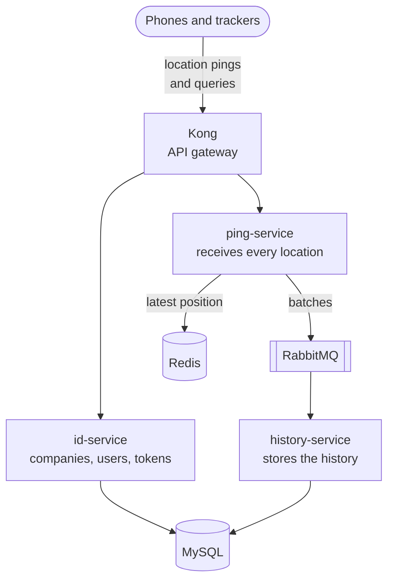
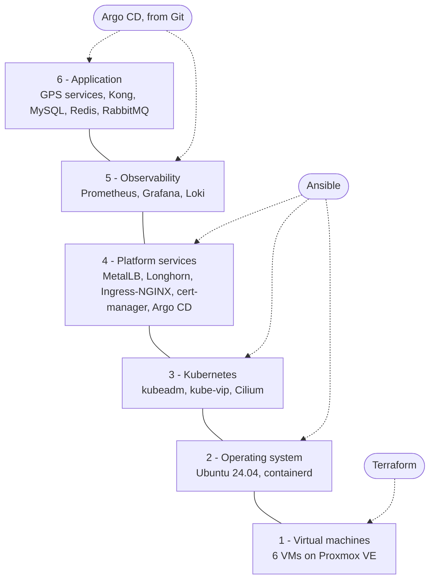
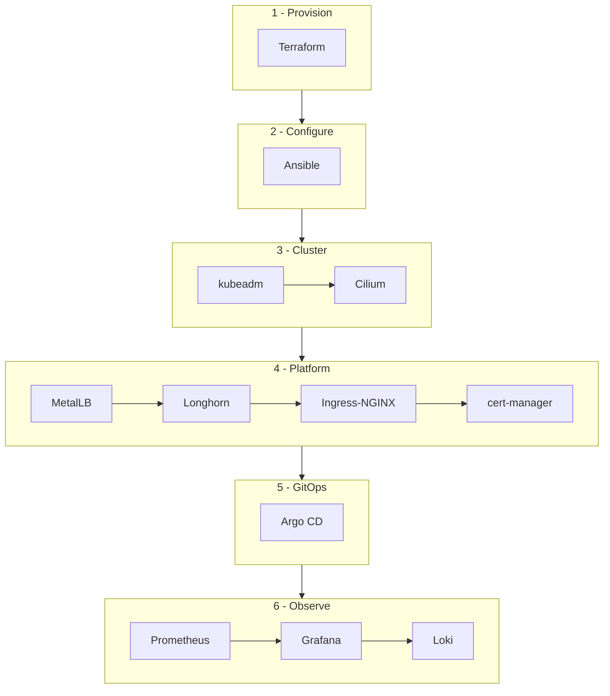
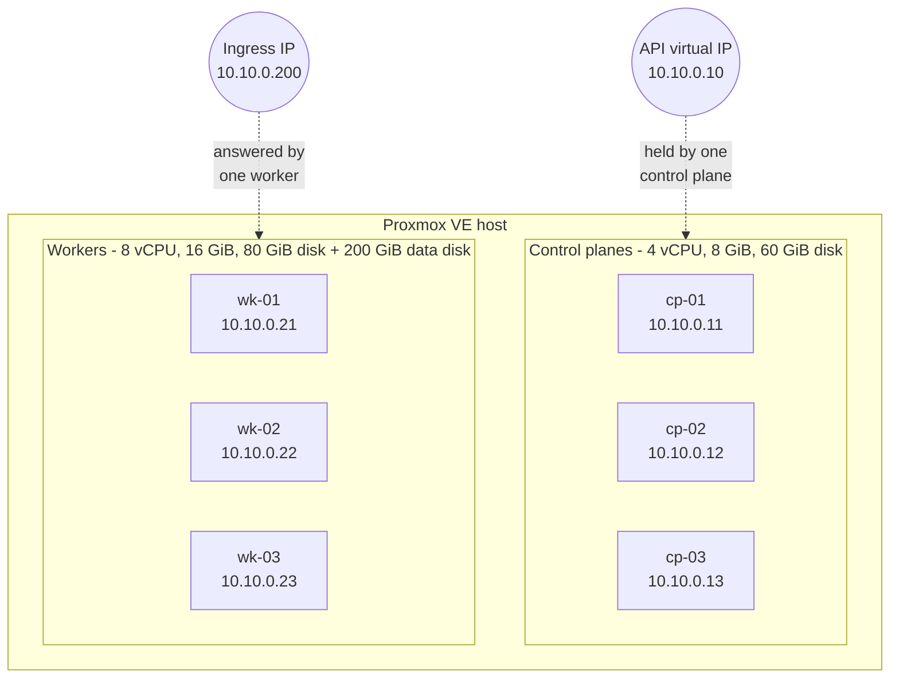
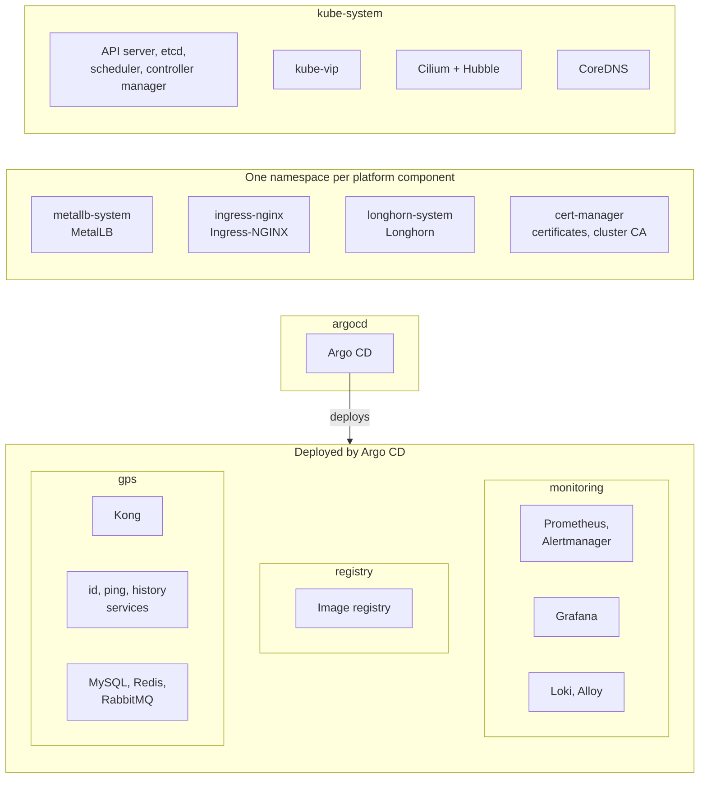
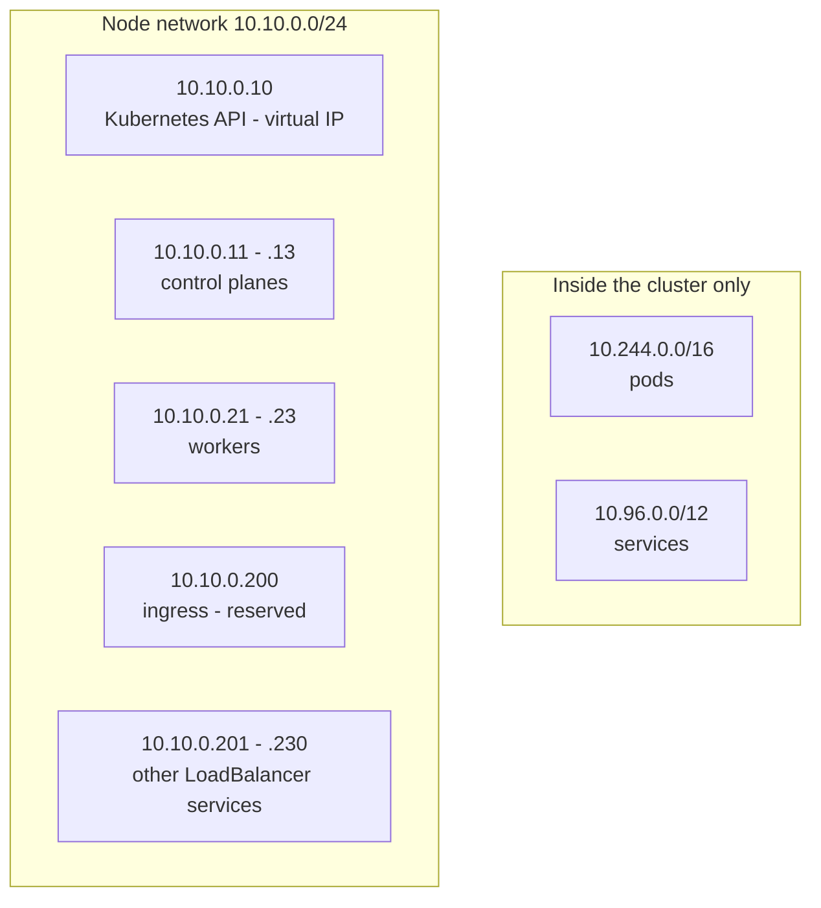
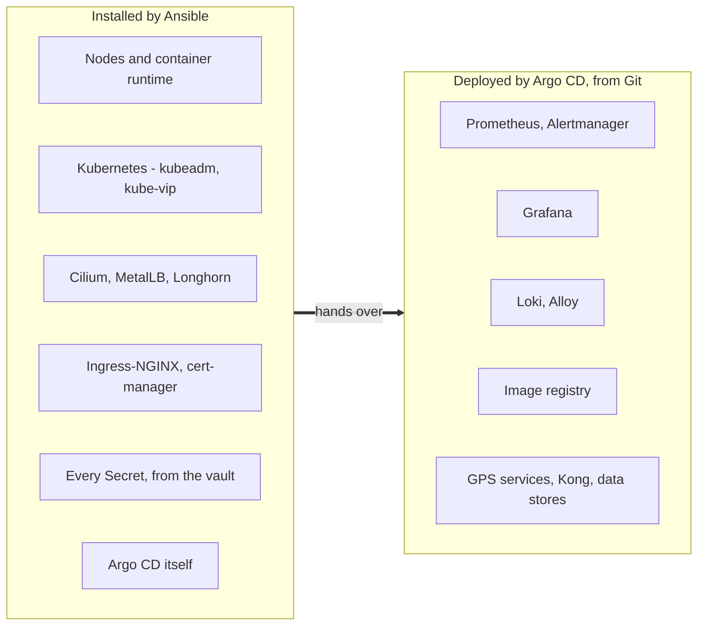

# 1 — The big picture

[← Start](README.md) · Next: [The twelve layers →](02-the-twelve-layers.md)

---

## The problem

The Realtime GPS Server collects location "pings" from thousands of devices, keeps every user's
latest position for "who is near me?" queries, and stores the full history. It is a set of Spring
Boot microservices behind the Kong API gateway, with MySQL, Redis and RabbitMQ.

On a laptop this runs with Docker Compose. **The goal of this platform:** run it in production on
hardware the organisation owns — no cloud provider — with the reliability, security and automation
a cloud would give.

---

## The idea: infrastructure as code, all the way down

Every layer, from the virtual machines to the application, is described in this Git repository and
built by a tool. Nothing is configured by hand, so the whole platform can be rebuilt from scratch and
every change is a reviewed commit.

> [!NOTE]
> **One sentence to remember:** *Terraform builds the machines, Ansible builds the cluster, Git
> (through Argo CD) runs everything on top.*

---

## The pipeline, in order

The twelve tools, grouped by what they achieve. Each one stands on the previous ones.

| Phase | Tools | What you have afterwards |
|---|---|---|
| Provision | Terraform | Six Ubuntu VMs with fixed addresses, and an inventory file listing them |
| Configure | Ansible | Nodes ready for Kubernetes: swap off, kernel settings, container runtime, Kubernetes packages |
| Cluster | kubeadm, Cilium | A working, highly available cluster with a pod network |
| Platform | MetalLB, Longhorn, Ingress-NGINX, cert-manager | Services reachable from outside, durable storage, HTTPS for every name |
| GitOps | Argo CD | A cluster that keeps itself in line with Git |
| Observe | Prometheus, Grafana, Loki | Metrics, dashboards, alerts and searchable logs |

---

## The physical view

Six virtual machines on Proxmox VE. Control planes run Kubernetes itself; workers run the
applications and hold the storage.

**Why three control planes?** Kubernetes stores its state in **etcd**, which needs a majority
(*quorum*) to work. With three members it survives losing one. Two would survive nothing; four
would survive the same one failure as three.

The diagram shows one Proxmox host for simplicity — but then that host is a single point of
failure. Spreading the VMs over two or more hosts, and what each layout protects, is
[page 10](10-proxmox-hosts.md).

---

## The logical view: what runs inside the cluster

Kubernetes groups workloads into **namespaces**. Each platform tool lives in its own.

---

## The address plan

Everything sits on one network, `10.10.0.0/24`, and every address is set in Terraform. It refuses a
plan in which two nodes share an address, or the API's or the ingress's address is also given to a
node.

| DNS name | Points to | Serves |
|---|---|---|
| `*.rls.internal` | `10.10.0.200` | every web UI and the API, through Ingress-NGINX |
| `k8s-api.rls.internal` | `10.10.0.10` | the Kubernetes API (optional) |

Names behind the wildcard: `api` (the GPS API), `argocd`, `grafana`, `prometheus`,
`alertmanager`, `hubble`, `longhorn`, `registry`.

---

## Who installs what

The most important design decision: **a clear hand-over from Ansible to Argo CD.**

**Why split it?** It's a design choice, made for two reasons. Some layers need work on the nodes
themselves — preparing Longhorn's disks, trusting the cluster CA — which is Ansible's job anyway.
And the rest are what Argo CD itself runs on and is reached through: the pod network, the ingress,
the certificates. Kept out of Argo CD, a bad sync can never break what Argo CD would need to repair
it. (Many teams do let Argo CD manage MetalLB or cert-manager; it works, with that risk.) Everything
above lives in Git, where it gains review, history and rollback. Secrets are always written by
Ansible — Git only refers to them by name.

---

## Key decisions at a glance

| Decision | Why | Alternative considered |
|---|---|---|
| Proxmox VE + Terraform | The most common open-source hypervisor; only one Terraform module is Proxmox-specific | vSphere, bare metal — swap the module, keep the rest |
| kubeadm, three control planes | Upstream Kubernetes, no vendor layer; three survive one failure | k3s, RKE2 — simpler, but less like the Kubernetes interviewers ask about |
| kube-vip for the API address | The API needs a stable address *before* the cluster exists | An external load balancer (HAProxy + keepalived) — more machines |
| Cilium without kube-proxy | eBPF networking: faster, one component, built-in flow visibility | Calico, Flannel + kube-proxy |
| MetalLB in Layer 2 mode | Works on any flat network, no router changes | BGP mode — needs routers that speak BGP |
| Longhorn | Replicated block storage on the workers' own disks | Ceph/Rook — far more to operate |
| Internal CA with cert-manager | No internet needed for certificates | Let's Encrypt — needs public DNS or reachability |
| Argo CD, app of apps | Git is the truth; drift is corrected automatically | Flux; or Helm from a pipeline — no drift correction |
| Every version pinned, node downloads checksummed | Reproducible builds, supply-chain safety | "latest" — unpredictable |

---

[← Start](README.md) · Next: [The twelve layers →](02-the-twelve-layers.md)
