# 2 — The twelve layers

[← The big picture](01-the-big-picture.md) · Next: [How it all flows →](03-how-it-all-flows.md)

Every tool gets the same treatment: what it is in one sentence, an everyday comparison, what it
does here (with a picture), the decisions behind it, and a line you can say in an interview.

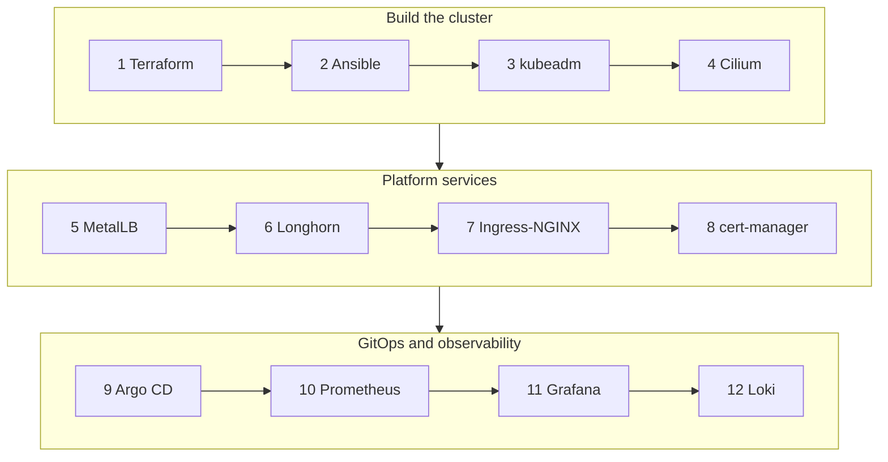

---

## 1. Terraform — builds the machines

> **In one sentence:** Terraform describes the virtual machines in code and creates them on Proxmox
> through its API.
>
> **Think of it as** the architect and builder: you hand over the plan, it builds exactly that, and
> it can tell you what would change before changing anything.

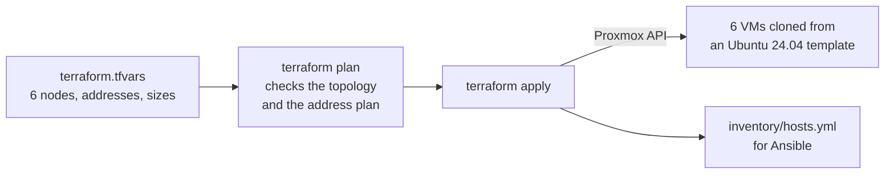

**What it does here**
- Clones six VMs from an Ubuntu 24.04 cloud-init template, with static IPs and SSH keys.
- Gives each worker a second, empty 200 GiB disk for Longhorn.
- **Validates the address plan** before creating anything: the API's virtual IP or the ingress IP
  colliding with a node fails the plan.
- **Writes the Ansible inventory**, so Ansible always knows exactly which machines exist.

**Decisions worth mentioning**
- Only one module (`modules/proxmox-vm`) is Proxmox-specific: moving to vSphere means replacing it.
- Terraform may not reboot a VM on its own (`allow_vm_reboot = false`): a resize that needs a
  reboot is a deliberate step, after draining the node.
- The Proxmox token is passed as an environment variable, never stored in a file.

> **Interview soundbite:** *"Terraform owns the machines and every address on the node network. It
> validates the address plan and hands Ansible a generated inventory, so there's no copy-pasted list
> of IPs anywhere."*

*Where:* `infra/terraform` · details: [01 — Terraform](../on-prem/01-terraform.md)

---

## 2. Ansible — turns machines into Kubernetes nodes, then builds the platform

> **In one sentence:** Ansible connects to each VM over SSH and configures it — and later installs
> the cluster and its platform components — from playbooks in the repository.
>
> **Think of it as** the electrician and plumber who fit out each house to the same standard, and
> can come back any time to check nothing has been changed.

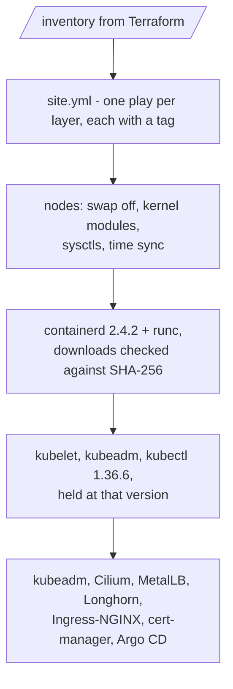

**What it does here**
- **Prepares every node**: swap off, kernel modules and settings Kubernetes needs, time sync.
- **Installs containerd from its official release**, not Ubuntu's package, so every node runs the
  exact pinned version. Each download is checked against a SHA-256 checksum stored in the repo.
- **Installs the Kubernetes packages and holds them**, so a routine `apt upgrade` can never move
  them — and a **version guard** refuses to change the version of a running node outside a proper
  upgrade.
- Runs every later layer: the cluster, the platform charts, the secrets, Argo CD.

**Decisions worth mentioning**
- **Idempotent**: running it twice changes nothing the second time. Safe to re-run any time.
- **Tags per layer**: `--tags cilium` re-applies just Cilium.
- **Secrets in Ansible Vault**: one encrypted file, never committed.
- Works without internet: download locations and container registry mirrors are variables.

> **Interview soundbite:** *"Ansible is idempotent and tagged by layer. Versions live in one file
> with their checksums, and a version guard stops a re-run from silently upgrading a kubelet past
> its API server."*

*Where:* `infra/ansible` · details: [02 — Ansible](../on-prem/02-ansible.md)

---

## 3. kubeadm (+ kube-vip) — creates a highly available cluster

> **In one sentence:** kubeadm is the official tool that turns prepared machines into a Kubernetes
> cluster; kube-vip gives the cluster's API one stable address that survives losing a control plane.
>
> **Think of it as** forming the town council (three members, majority rules) and giving it one
> public phone number that is always answered, whoever is on duty.

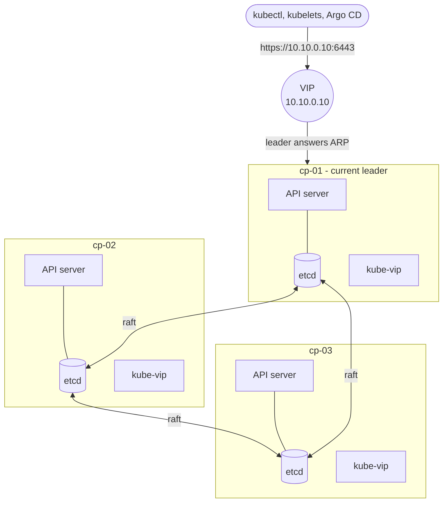

**What it does here**
- `kubeadm init` on the first control plane, from a **validated** configuration file.
- The other two control planes join **one at a time**; then the three workers join.
- Each join uses its **own bootstrap token, valid for 15 minutes**, created only when that node
  needs it. The file holding it is deleted straight after the join — even a failed one.
- **kube-vip** runs on each control plane. They elect a leader, which takes the address
  `10.10.0.10`. If the leader dies, another takes over within 15–20 seconds.

**Decisions worth mentioning**
- **kube-proxy is disabled** in the cluster configuration itself, so Cilium can replace it — and
  upgrades will not quietly reinstall it.
- **The "super-admin" bootstrap problem:** on Kubernetes 1.29+, kube-vip must start with
  `super-admin.conf` on the first node, because `admin.conf` only gets its permissions once the API
  is up — and the API needs the VIP. The playbook handles that switch automatically.
- Control plane metrics are exposed so Prometheus can monitor etcd, the scheduler and the
  controller manager.

> **Interview soundbite:** *"Three control planes with stacked etcd behind a kube-vip address. I hit
> the 1.29 super-admin.conf chicken-and-egg problem: kube-vip needs credentials that only work once
> the API is up, and the API needs the VIP — so the first node bootstraps with super-admin and
> switches after init."*

*Where:* roles `kubeadm_init`, `kubeadm_join`, `kube_vip` · details:
[03 — Kubernetes](../on-prem/03-kubernetes.md)

---

## 4. Cilium — the network between pods

> **In one sentence:** Cilium gives every pod an IP address and connects them, using eBPF programs
> inside the Linux kernel instead of thousands of iptables rules.
>
> **Think of it as** the road network and the traffic police: it builds the roads between houses,
> decides who may drive where, and records every journey.

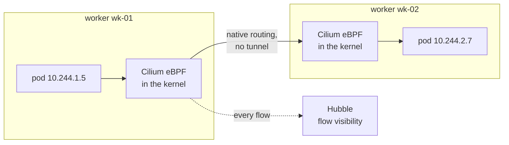

**What it does here**
- **Pod networking (CNI):** pods get addresses from `10.244.0.0/16`.
- **Replaces kube-proxy:** Kubernetes Services are implemented in eBPF — faster, and one less moving
  part.
- **Network policies:** the "who may talk to whom" rules of page 4 are enforced here.
- **Hubble** shows every network flow — invaluable for debugging ("why is this connection
  dropped?").

**Decisions worth mentioning**
- **Native routing**: pod packets travel between nodes as they are, without VXLAN encapsulation —
  possible because all nodes share one network, which Terraform guarantees.
- **Its own load-balancer IPAM is switched off**, so MetalLB alone hands out service addresses.

> **Interview soundbite:** *"Cilium in kube-proxy replacement mode with native routing. I switched
> off its LoadBalancer IPAM so it wouldn't compete with MetalLB — two components handing out the
> same addresses would be a nasty, intermittent bug."*

*Where:* role `cilium` · details: [03 — Kubernetes](../on-prem/03-kubernetes.md#cilium-the-pod-network)

---

## 5. MetalLB — gives services an address on our network

> **In one sentence:** In the cloud, a `LoadBalancer` Service gets a public IP automatically; on our
> own hardware, MetalLB provides that by announcing addresses from a pool on the local network.
>
> **Think of it as** the switchboard that gives a department a public phone number, and makes sure
> one desk always picks up.

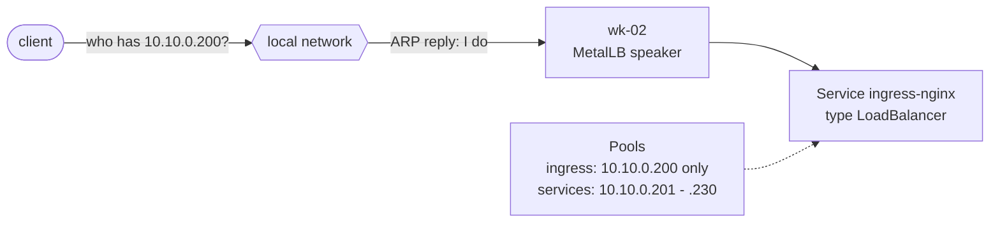

**What it does here**
- **Layer 2 mode:** one worker answers ARP for each address; if it dies, another takes over within
  seconds.
- **Two pools:** `10.10.0.200` is reserved for the ingress controller (never handed out
  automatically); the rest of the range is for any other Service.

**Decisions worth mentioning**
- Layer 2 needs nothing from the network team; BGP mode would spread load but needs BGP routers.
- The chart installs BGP components by default — switched off, since nothing here speaks BGP.
- Speakers run on workers only: kubeadm marks control planes as excluded from load balancers.

> **Interview soundbite:** *"MetalLB in Layer 2 mode with the ingress IP in its own pool that is
> never auto-assigned — so the address DNS points at can't be grabbed by another service first."*

*Where:* role `metallb` · details: [04 — Networking](../on-prem/04-networking.md)

---

## 6. Longhorn — storage that survives a node failure

> **In one sentence:** Longhorn turns the workers' spare disks into replicated block storage: every
> volume is kept three times, on three different workers.
>
> **Think of it as** a warehouse that keeps three copies of every box in three different buildings.

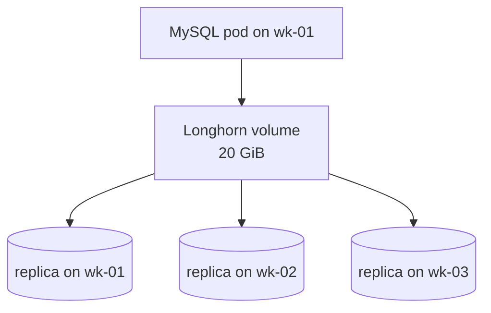

**What it does here**
- The default **StorageClass**: any app asking for a volume gets a three-way replicated one.
- Each worker's **200 GiB data disk** is formatted and mounted for it — but **only after a safety
  check** confirms the disk is empty and unpartitioned, so a typo can never wipe the OS disk.
- When a node dies, pods stuck there are deleted so they restart elsewhere with their volume.

**Decisions worth mentioning**
- Usable capacity is roughly one disk's worth (three copies), ~150 GiB here.
- Longhorn's own network policy keeps its internals private; Prometheus alone is allowed in to
  scrape metrics.
- No "phoning home": update checks and usage reporting are off.

> **Interview soundbite:** *"Longhorn with three replicas per volume. The disk preparation checks
> `lsblk` first and refuses anything with partitions or a foreign filesystem — formatting is the one
> operation you can't undo."*

*Where:* roles `longhorn_node`, `longhorn` · details: [05 — Storage](../on-prem/05-storage.md)

---

## 7. Ingress-NGINX — the front door

> **In one sentence:** Ingress-NGINX receives all HTTPS traffic on `10.10.0.200` and routes each
> request to the right service by its host name.
>
> **Think of it as** the reception desk: everyone comes in through one door, shows which department
> they want, and is sent there.

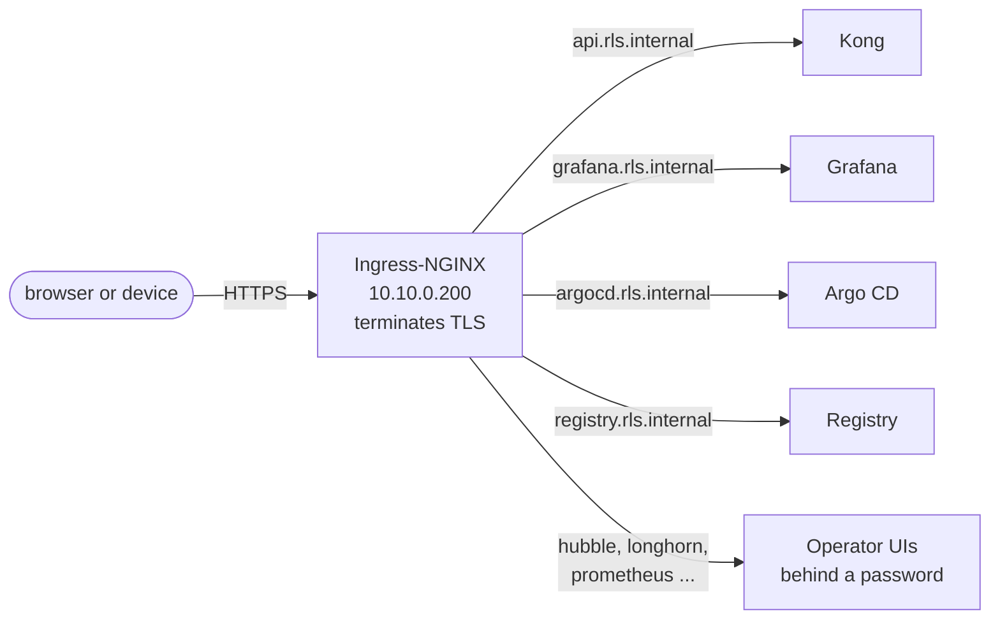

**What it does here**
- Runs on every worker (DaemonSet) and keeps the **real client IP** (`externalTrafficPolicy:
  Local`).
- Writes **JSON access logs**, so Loki can search by status code or latency without parsing.
- Serves a wildcard `*.rls.internal` certificate by default.

**Decisions worth mentioning**
- **The project was archived in March 2026**: version 1.15.1 is final. Because it gets no more
  security fixes, its exposure is minimised — a Cilium policy lets only the Kubernetes API server
  reach its admission webhook, the path the 2025 "IngressNightmare" attacks used.
- The migration path to the Gateway API (Cilium) is documented.

> **Interview soundbite:** *"Ingress-NGINX was archived this year, so I treated it as a liability:
> I locked its admission webhook down to the API server — exactly the attack path of IngressNightmare
> — and documented the move to Cilium's Gateway API."*

*Where:* role `ingress_nginx` · details: [04 — Networking](../on-prem/04-networking.md#ingress-nginx)

---

## 8. cert-manager — HTTPS for everything, without the internet

> **In one sentence:** cert-manager runs a private certificate authority inside the cluster and
> automatically issues and renews a certificate for every HTTPS name.
>
> **Think of it as** the town's own passport office: it issues and renews ID cards, and everyone
> who trusts the office trusts the cards.

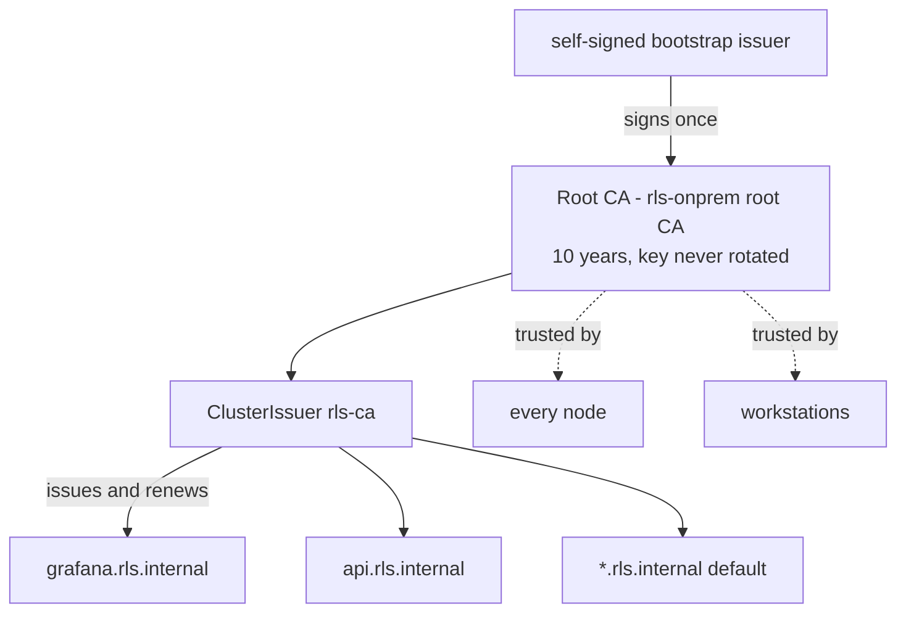

**What it does here**
- Creates a **root CA** inside the cluster and a `ClusterIssuer` called `rls-ca`.
- Any Ingress with the annotation `cert-manager.io/cluster-issuer: rls-ca` gets a certificate,
  renewed automatically.
- Ansible installs the CA certificate on **every node**, so containerd trusts the private registry.

**Decisions worth mentioning**
- **No ACME / Let's Encrypt**: an on-prem cluster can't assume the internet can reach it.
- The root CA's key is **never rotated**, so clients keep trusting it across renewals.
- An enterprise CA can be plugged in instead (bring-your-own intermediate).

> **Interview soundbite:** *"An internal CA through cert-manager: no dependency on public DNS or the
> internet, every node trusts it, and certificates renew themselves."*

*Where:* roles `cert_manager`, `cluster_ca_trust` · details: [06 — TLS](../on-prem/06-tls.md)

---

## 9. Argo CD — Git runs the cluster

> **In one sentence:** Argo CD watches the Git repository and continuously makes the cluster match
> it — deploying changes and undoing anything changed by hand.
>
> **Think of it as** an autopilot holding the course set in the flight plan: if the plane drifts, it
> corrects itself.

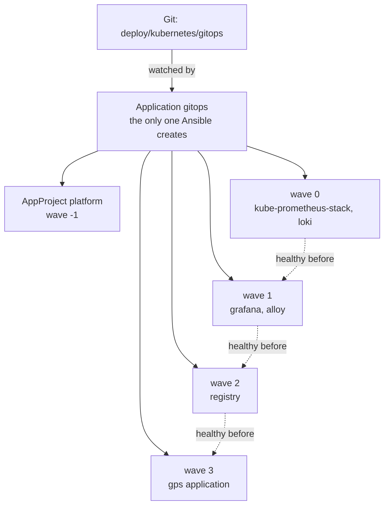

**What it does here**
- **App of apps:** Ansible creates one Application, which renders all the others from Git.
- **Sync waves:** monitoring first, so everything after it is watched from its first pod.
- **Self-healing:** a manual `kubectl edit` is reverted; removing something from Git removes it from
  the cluster.

**Decisions worth mentioning**
- A custom health check makes each wave wait until the previous one is *healthy*, not merely created.
- Cluster-specific settings (domain, issuer) are passed in by Ansible, so Git holds no environment
  details.
- **Rollback is `git revert`.**

> **Interview soundbite:** *"An app-of-apps with sync waves — monitoring first, application last —
> and a restored health check so each wave really waits for the previous one. A release is a
> one-line Git change; a rollback is a revert."*

*Where:* role `argocd`, `deploy/kubernetes/gitops` · details: [07 — GitOps](../on-prem/07-gitops.md)

---

## 10. Prometheus — metrics and alerts

> **In one sentence:** Prometheus collects numbers (metrics) from every component every 30 seconds,
> stores them, and fires alerts when rules are broken.
>
> **Think of it as** the meters on every machine in a factory, plus the alarm that rings when a
> reading goes red.

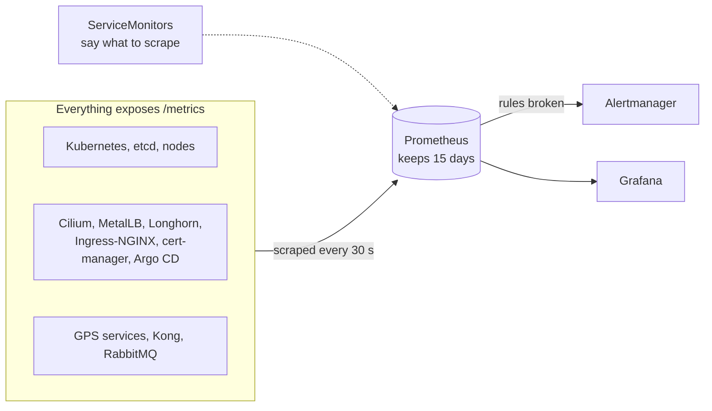

**What it does here**
- **kube-prometheus-stack** deploys Prometheus, Alertmanager, node-exporter and kube-state-metrics.
- It picks up **every ServiceMonitor in the cluster** — and every earlier layer already shipped one,
  so it monitors everything from its first start.
- Application alerts: a component down, error rate above 5 %, slow requests, a growing queue.

**Decisions worth mentioning**
- The CRDs (ServiceMonitor and friends) are installed by Ansible **before** any add-on, so every
  chart can ship monitoring objects from day one.
- Keeps 15 days or 25 GB, whichever comes first.
- **Alerts aren't routed anywhere yet.** They show in Alertmanager and Grafana; sending them to
  e-mail, chat or a pager is a values change, with the credentials in a Secret from the vault.

> **Interview soundbite:** *"I installed the Prometheus Operator CRDs before anything else, so every
> layer shipped its own ServiceMonitor. When Prometheus arrived it was already monitoring the whole
> platform."*

*Where:* `deploy/kubernetes/gitops/values/kube-prometheus-stack.yaml` · details:
[08 — Observability](../on-prem/08-observability.md)

---

## 11. Grafana — the dashboards

> **In one sentence:** Grafana turns Prometheus metrics and Loki logs into dashboards anyone can
> read.
>
> **Think of it as** the control room's wall of screens.

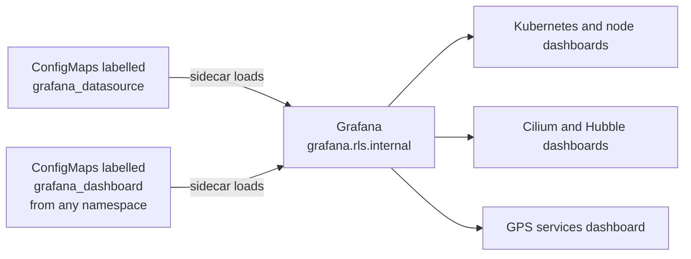

**What it does here**
- **Everything is provisioned, nothing clicked:** data sources and dashboards come from labelled
  ConfigMaps, so they're version-controlled.
- Admin password from the vault; no update checks or usage reporting.

> **Interview soundbite:** *"Dashboards and data sources are provisioned from ConfigMaps — my GPS
> dashboard ships in the same chart as the application it describes."*

*Where:* `deploy/kubernetes/gitops/values/grafana.yaml` · details:
[08 — Observability](../on-prem/08-observability.md#grafana)

---

## 12. Loki (+ Alloy) — searchable logs

> **In one sentence:** Alloy collects every container's logs on every node and ships them to Loki,
> which stores them cheaply and makes them searchable in Grafana.
>
> **Think of it as** a central logbook: every machine writes into it, and you can search all of it
> at once.

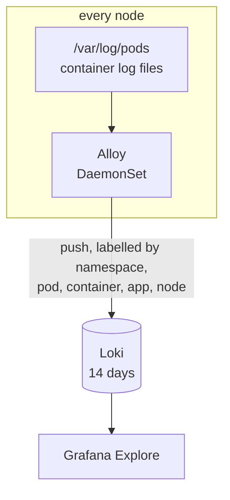

**What it does here**
- **Alloy** (Promtail's successor — Promtail is end-of-life) reads each pod's log files straight
  from the node's disk, instead of streaming them through the Kubernetes API.
- **Loki** runs as a single binary on a 30 GiB Longhorn volume and keeps 14 days.
- The GPS services log **JSON**, so you can follow one request across all of them by the
  correlation id Kong attaches to it.

> **Interview soundbite:** *"Ingress-NGINX's access logs and the Spring services' logs are JSON, so
> Loki can filter on any field — and I can follow one request through every GPS service by the
> correlation id Kong gives it."*

*Where:* `deploy/kubernetes/gitops/values/loki.yaml`, `alloy.yaml` · details:
[08 — Observability](../on-prem/08-observability.md#loki-and-alloy)

---

## The supporting cast

| Component | Role in one line |
|---|---|
| **containerd** | Runs the containers on each node (Kubernetes' container runtime) |
| **Helm** | Package manager for Kubernetes: most components are installed as Helm charts |
| **Ansible Vault** | Encrypts the one file that holds every secret |
| **Kong** | The application's API gateway: authentication, rate limits, routing to services |
| **Image registry** | The cluster's own Docker registry, so it never depends on Docker Hub for its own software |
| **GitHub Actions** | Runs the validation script on every change |

---

[← The big picture](01-the-big-picture.md) · Next: [How it all flows →](03-how-it-all-flows.md)
