# 3 — How it all flows

[← The twelve layers](02-the-twelve-layers.md) · Next: [Security →](04-security.md)

Pages 1 and 2 show the parts. This page shows them working together: the "what happens when…?"
stories interviewers ask you to walk through. Each has one diagram to draw and a few points to say.

| # | Story | What it shows you understand |
|---|---|---|
| 1 | [Building the platform from nothing](#1-building-the-platform-from-nothing) | The order of the layers, and why |
| 2 | [A node joins the cluster](#2-a-node-joins-the-cluster) | How Kubernetes and a new machine learn to trust each other |
| 3 | [A location ping, end to end](#3-a-location-ping-end-to-end) | One request through every layer, from DNS to the database |
| 4 | [Who is near me?](#4-who-is-near-me) | Reading from Redis's geo index, per tenant |
| 5 | [Signing up and getting a token](#5-signing-up-and-getting-a-token) | Authentication at the gateway |
| 6 | [Releasing a new version](#6-releasing-a-new-version) | GitOps: a release is a commit, a rollback is a revert |
| 7 | [A certificate is issued and renewed](#7-a-certificate-is-issued-and-renewed) | HTTPS with no manual steps |
| 8 | [Metrics and logs](#8-metrics-and-logs) | How you find out something is wrong, and why |
| 9 | [A secret, from the vault to a pod](#9-a-secret-from-the-vault-to-a-pod) | Secrets that never touch Git |

---

## 1. Building the platform from nothing

Two commands build the platform — `terraform apply` and `ansible-playbook site.yml` — and from then
on, every change is a `git push`. The application itself arrives with its first release
([story 6](#6-releasing-a-new-version)).

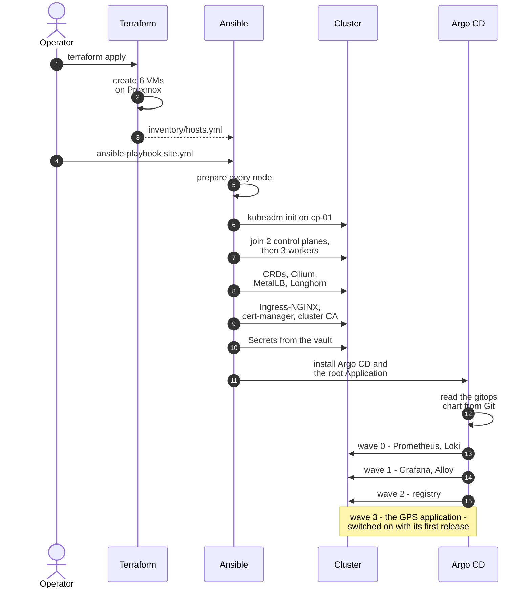

**Why this order?** Every step needs the one before it:

| Step | Must come after… | Because |
|---|---|---|
| Nodes join | kubeadm init | They join an API that must already exist, at the VIP |
| Cilium | the nodes | Nodes report `NotReady` and no pod starts until there is a pod network — this is expected |
| Prometheus CRDs | the cluster | Every later chart ships a `ServiceMonitor`, which only exists once its CRD does |
| MetalLB | Cilium | It runs as pods, and hands Ingress-NGINX its address |
| Longhorn | Cilium | Anything with data — Prometheus, Loki, MySQL — needs volumes |
| cert-manager | Ingress-NGINX | Its first certificate is the ingress's default wildcard certificate, created in Ingress-NGINX's namespace |
| Argo CD | all of the above | Its UI is served through the ingress with a certificate, and what it deploys needs volumes. Keeping those layers in Ansible means a bad sync can't break what Argo CD runs on |
| GPS application | everything, and a release | Last wave, so it is monitored and logged from its very first pod. It is switched on with the first release, once its images are in the registry |

---

## 2. A node joins the cluster

A new machine and the cluster have never met. Each must prove itself to the other.

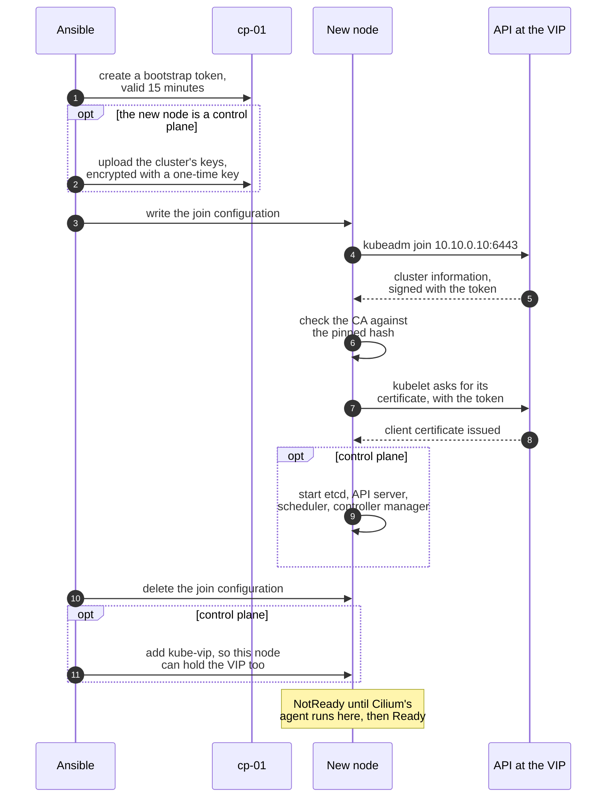

- **The node trusts the cluster** because the CA's public key matches the hash it was given — a
  machine in the middle can't impersonate the API.
- **The cluster trusts the node** because it presented a valid bootstrap token, created for this
  node alone and expiring after 15 minutes.
- **Control planes also need the cluster's private keys.** They travel encrypted, in a Secret that
  kubeadm deletes after two hours.

---

## 3. A location ping, end to end

The story to tell when asked *"walk me through a request"*. Three parts: the way in, the
synchronous work, and what happens after the device already has its answer.

### The way in

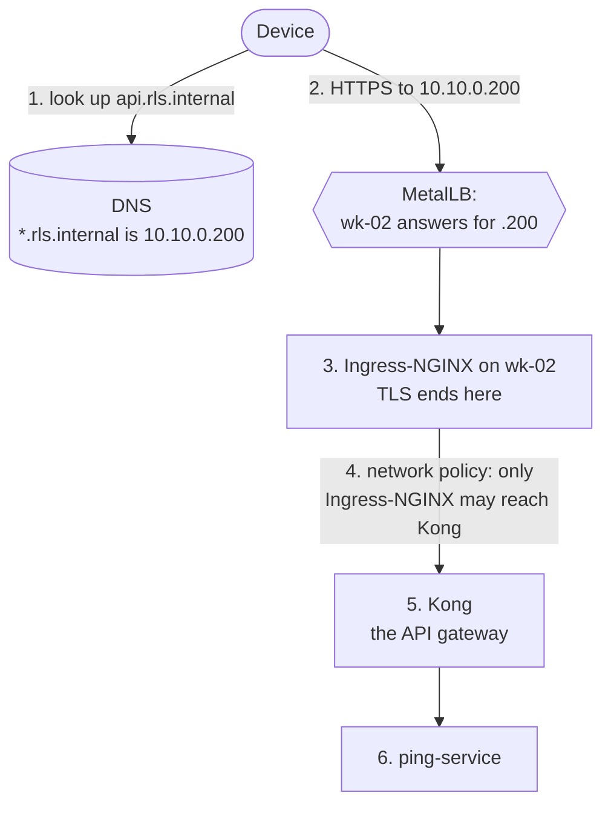

### The synchronous part — a few milliseconds

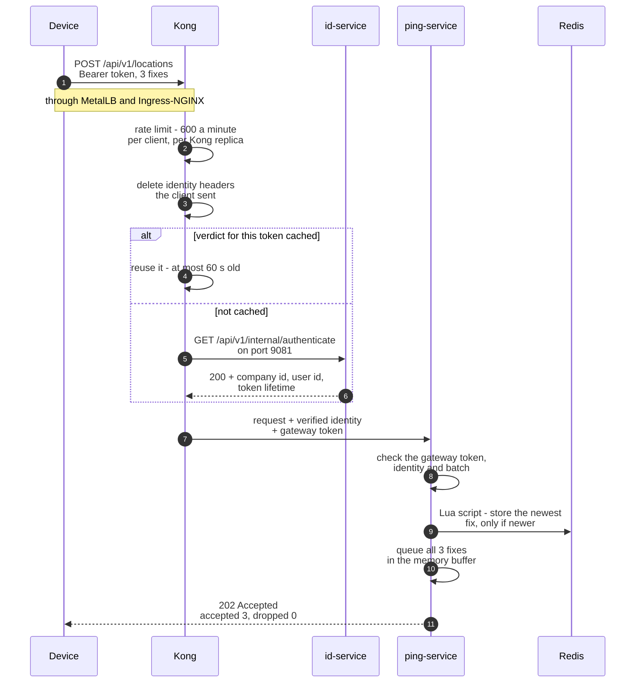

### The asynchronous part — after the device has its answer

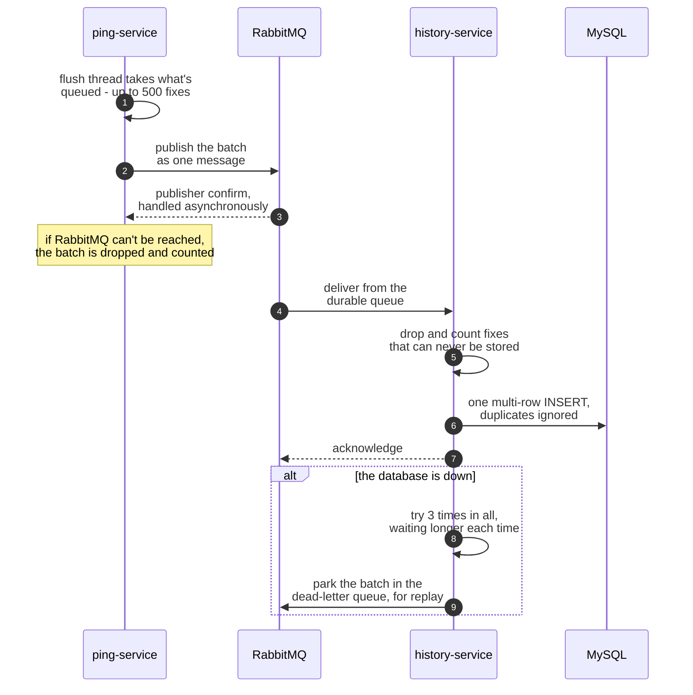

### Why it is built this way

| Design choice | Reason |
|---|---|
| Redis gets only the **newest** fix, RabbitMQ gets **every** fix | The current position is read constantly; the track is written once and read rarely |
| The "is it newer?" check runs **inside Redis**, as a Lua script | Devices send buffered fixes out of order; a read-then-write from Java would race with itself |
| Fixes are **batched**, up to 500 per message | At 1,500 requests a second, per-message overhead would dominate |
| The buffer is **bounded** at 50,000 fixes | An unbounded queue turns a slow broker into an out-of-memory crash; a bounded one sheds load and says so (`dropped` in the response) |
| The history insert is **idempotent** (a unique key on company, user and time) | RabbitMQ delivers *at least once*; a redelivered batch must not create duplicate rows |
| Kong **caches** auth decisions for at most 60 seconds | Otherwise every request would also be a call to id-service |

> [!IMPORTANT]
> **Say this before you're asked:** the `202` comes before the history is safe. Fixes wait in
> ping-service's memory until the flush thread publishes them — normally milliseconds, but the
> buffer can hold up to 50,000 if RabbitMQ is slow. A graceful shutdown (`SIGTERM`) drains it; a
> hard kill loses it. A batch RabbitMQ can't take is dropped and counted, not retried. That is a
> deliberate trade: the next fix from a device is a second away, and confirming every write first
> would cost a broker round trip per request. A payments system would choose differently.

---

## 4. Who is near me?

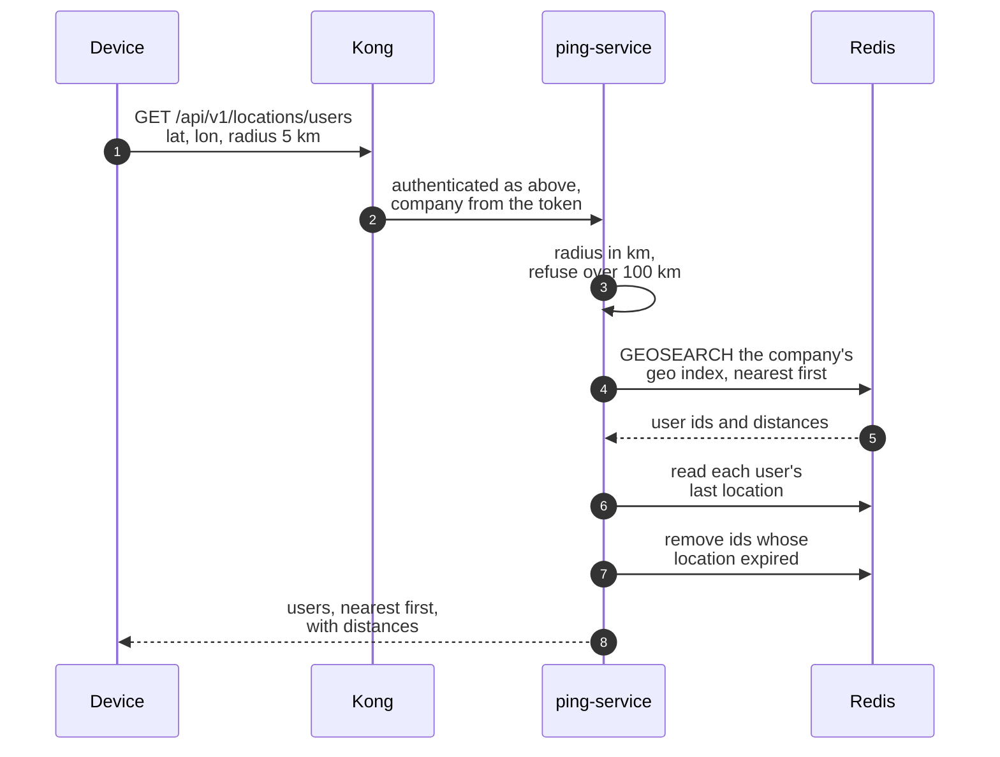

- **Tenants can't see each other.** Every Redis key contains the company id —
  `gps:<company>:geo`, `gps:<company>:last:<user>` — and the company comes from the verified token,
  never from the query.
- **Silent devices disappear.** A last location expires after 24 hours. Redis can't expire members of
  a geo index, so the search removes stale ones as it passes them — no clean-up job needed.
- **The radius cap is checked in kilometres**, so `radius=5000000&unit=M` is refused just like
  `radius=5000&unit=KM`.

---

## 5. Signing up and getting a token

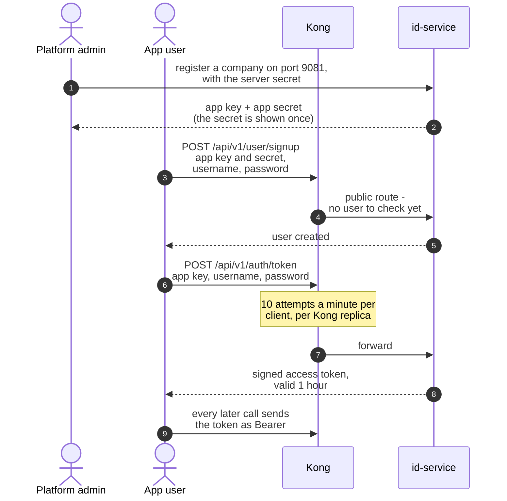

- **Company registration has no public route at all.** It is served only on id-service's internal
  port, which only Kong's pods can reach — and Kong has no route to it. An operator uses
  `kubectl port-forward`.
- **Only the hash of the app secret is stored** (bcrypt): a lost secret can't be recovered, not even
  by an administrator.
- **The token endpoint is the password-guessing surface**, so it gets its own, much lower rate
  limit.

---

## 6. Releasing a new version

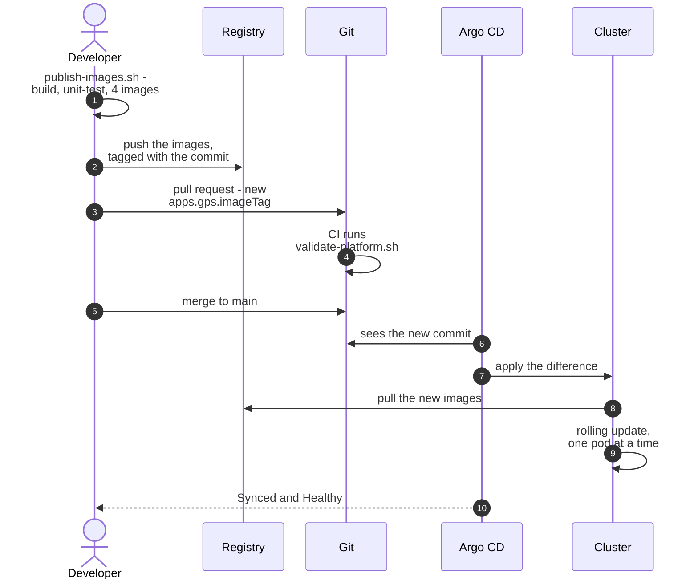

For the very first release, the same pull request also sets `apps.gps.enabled: true` — until then
the application's wave is switched off, because there are no images to run.

**How the rolling update avoids errors** — each service runs two pods, and:

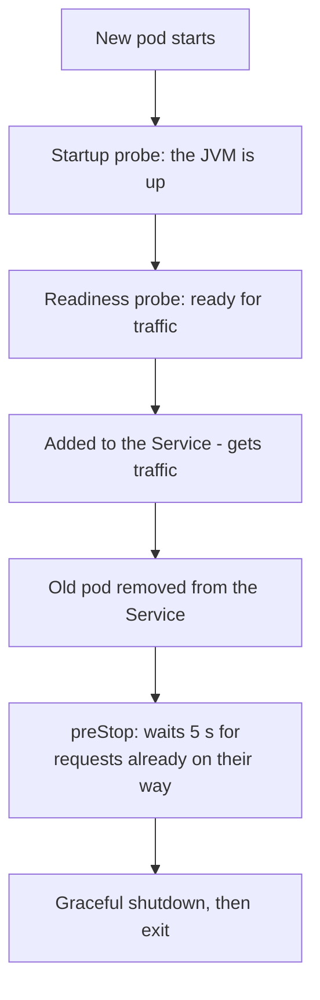

A `PodDisruptionBudget` keeps at least one pod of each service running during node drains, too.

> [!TIP]
> **Rollback is `git revert`** of the release commit. Argo CD rolls the old images back the same
> way. There is no "deploy" button and no `kubectl` in the release process — Git's history *is* the
> deployment history.

---

## 7. A certificate is issued and renewed

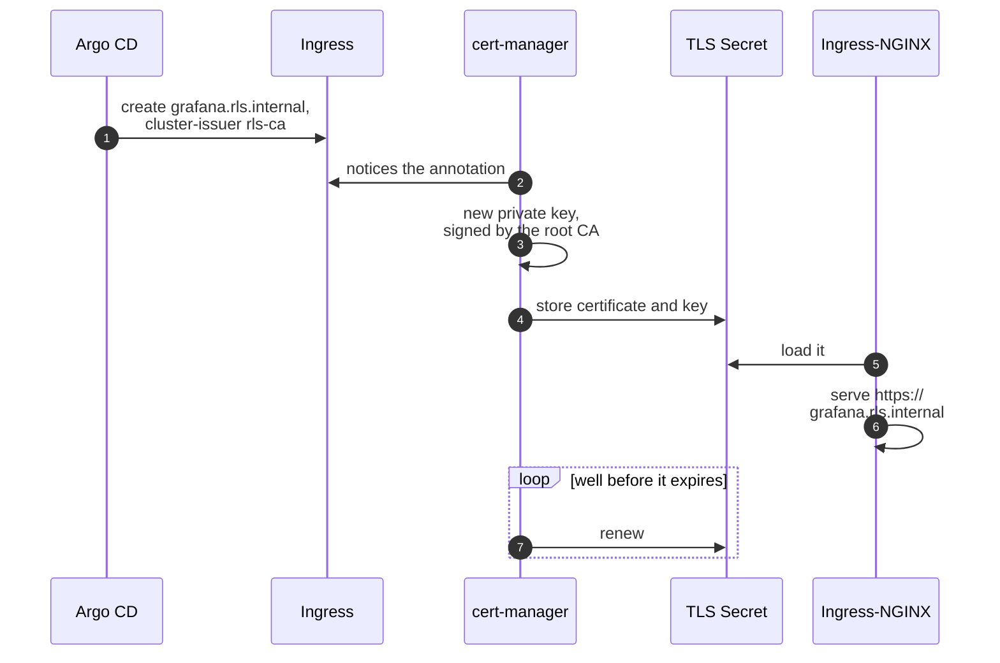

**Who trusts the certificate, and why:**

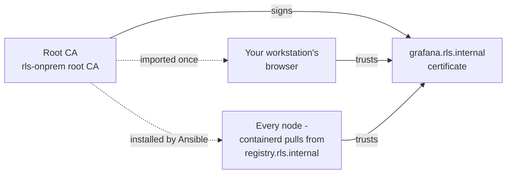

---

## 8. Metrics and logs

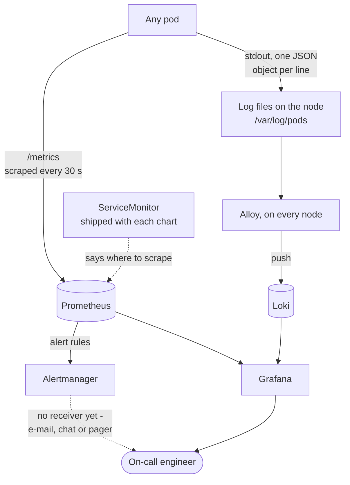

**A debugging scenario to walk through** — how the signals work together when something breaks:

1. **The alert.** `GpsComponentDown` fires for history-service, then `GpsLocationQueueBacklog`: over
   10,000 messages have been waiting in RabbitMQ for 10 minutes.
2. **The dashboard.** *GPS services* in Grafana shows the queue climbing and history-service storing
   nothing — while ping-service answers normally. Devices are unaffected: their requests go through
   Kong, id-service (and MySQL, for token checks), ping-service and Redis — never through
   history-service. Only the history is falling behind.
3. **The logs.** For that time window in Grafana's Explore view:

   ```text
   {namespace="gps", app="history-service"} | json | log_level="ERROR"
   ```

   shows MySQL refusing history-service's login, so the service fails at start-up.
4. **The cause.** Suppose history-service's database password was rotated in the vault earlier that
   day and the Secret rewritten — but MySQL sets a user's password only when its volume is first
   created, so it still has the old one. The runbook's extra step, an `ALTER USER` in MySQL, was
   missed.
5. **The fix.** Run the `ALTER USER`. history-service starts, works through the backlog, and **no
   location is lost**: the batches waited in RabbitMQ's durable queue — exactly what it is for.

> [!NOTE]
> **Contrast it with MySQL itself going down.** Then devices *do* notice: id-service checks every
> token Kong hasn't cached against MySQL, so within a minute logins and requests start failing. And
> history-service, still running, can't store the batches it receives: after three attempts each
> one goes to the dead-letter queue, to be replayed once MySQL is back.

To follow one request through every GPS service, filter on the correlation id Kong gave it — it is
also returned to the client in the `X-Correlation-Id` header:

```text
{namespace="gps"} | json | correlationId="7f3c9a1e-..."
```

Metrics tell you **that** something is wrong and **where**; logs tell you **why**.

---

## 9. A secret, from the vault to a pod

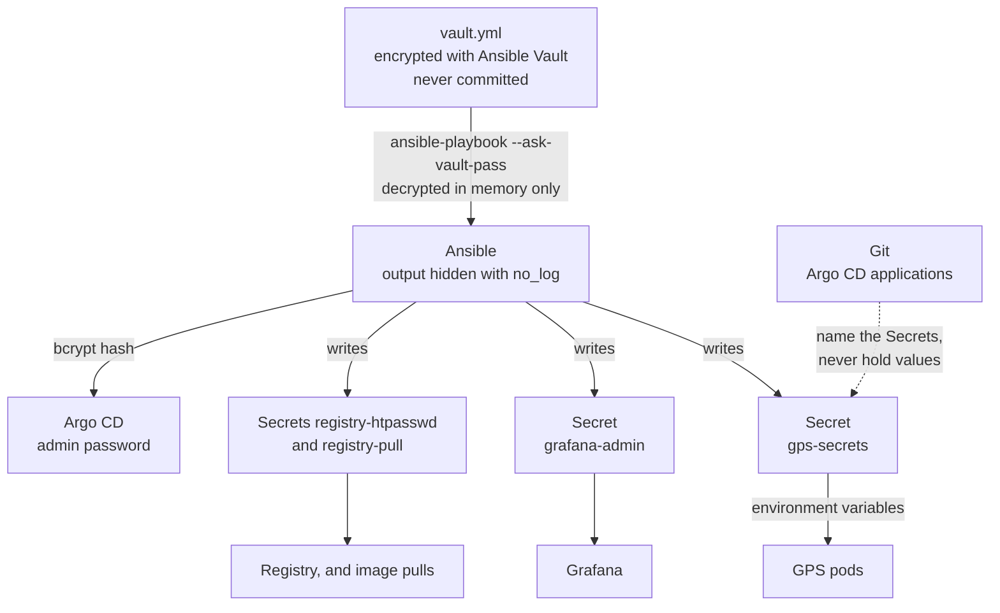

- **Git holds the shape, the vault holds the values.** A manifest says "read key `jwt-secret` from
  Secret `gps-secrets`"; only Ansible knows what it is.
- **One password, two forms that always match.** The registry's bcrypt entry and the cluster's pull
  credential are both derived from the same vault value. The bcrypt salt is derived too, so
  re-running Ansible changes nothing unless the password does.
- **Rotating a secret:** change it in the vault, re-run the layer that writes it — `--tags secrets`
  for the application's, `ops-ui` or `argocd` for theirs — and restart what reads it. A MySQL user's
  password also needs an `ALTER USER` in MySQL, which sets passwords only on first start.

---

[← The twelve layers](02-the-twelve-layers.md) · Next: [Security →](04-security.md)
