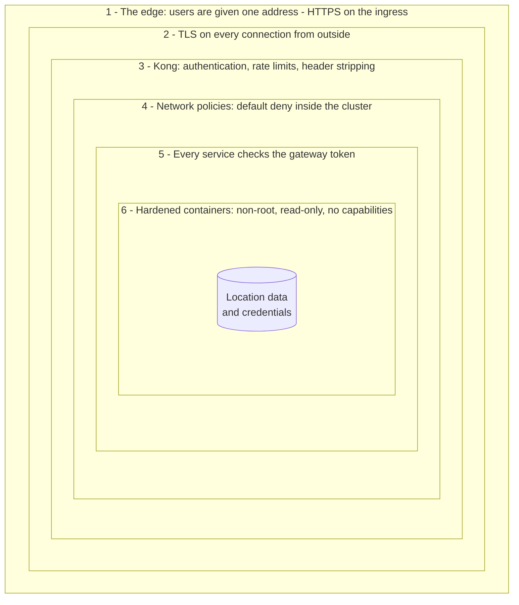
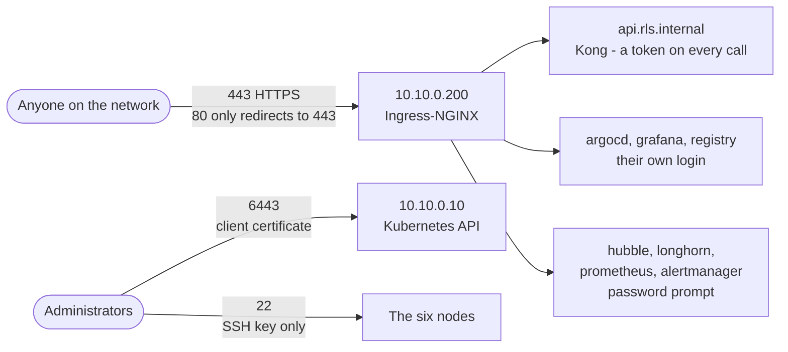
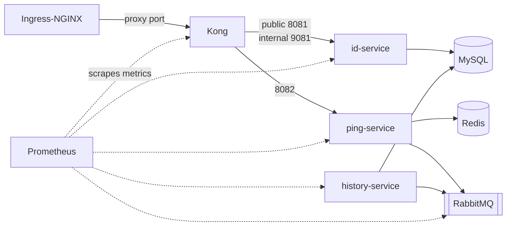
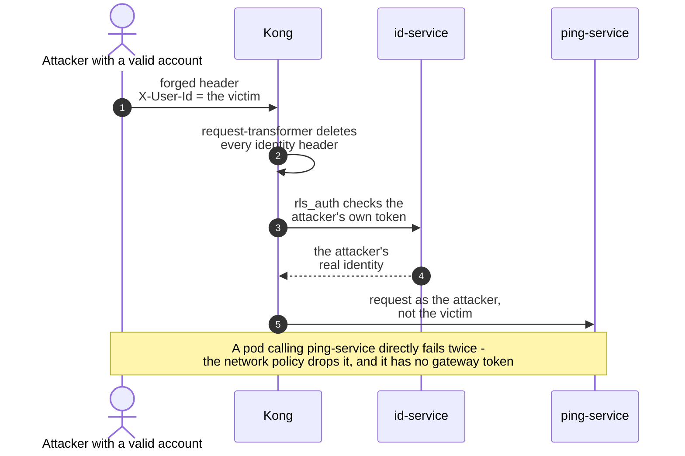
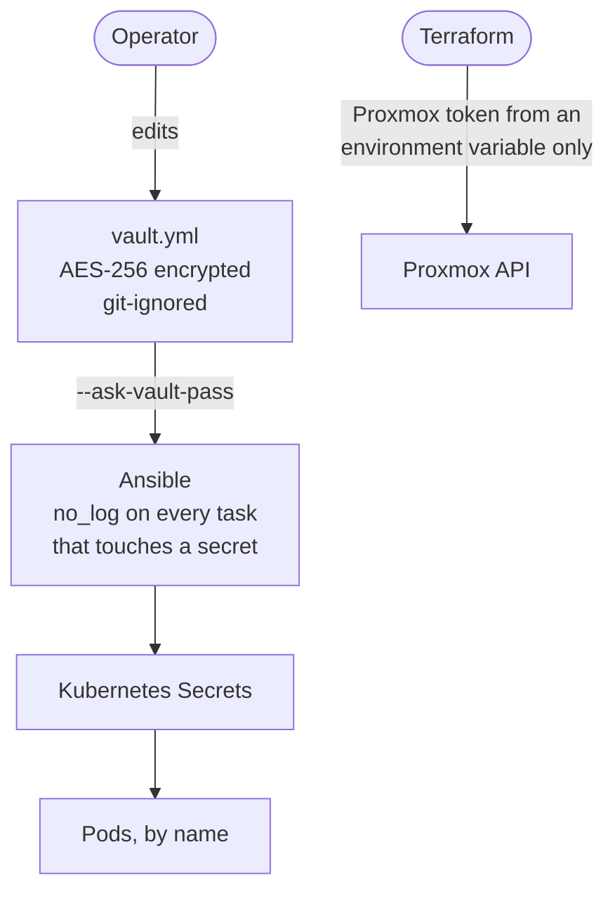
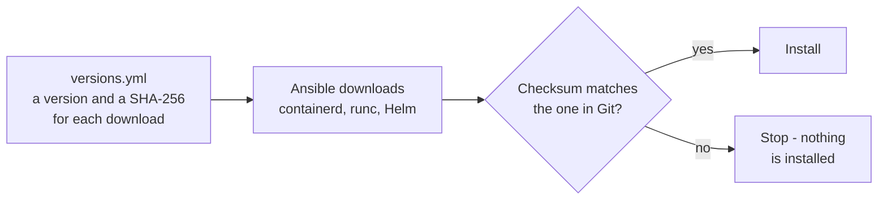
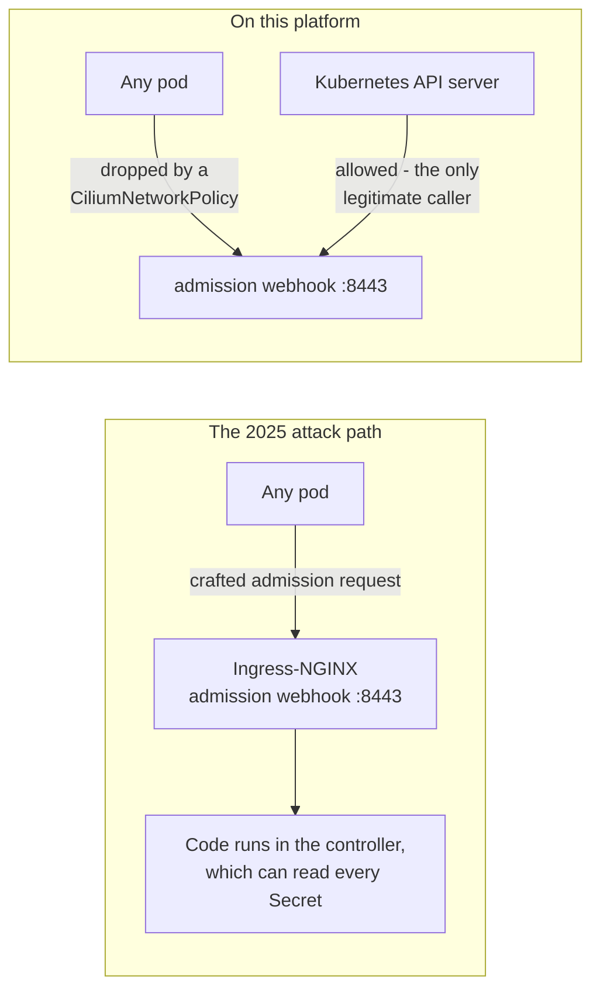

# 4 — Security

[← How it all flows](03-how-it-all-flows.md) · Next: [Reliability and operations →](05-reliability-and-operations.md)

**The principle: defence in depth.** No single control is trusted on its own — every layer assumes
the one in front of it might fail, and still protects what is behind it.

---

## The layers of defence

| Layer | Stops |
|---|---|
| 1. The edge | Users only ever use the ingress; the Kubernetes API and SSH need certificates and keys. There is no host firewall yet — [see below](#what-can-be-reached-from-outside) |
| 2. TLS | Eavesdropping and tampering between clients and the cluster |
| 3. Kong | Unauthenticated calls, forged identities, password guessing, one client overloading the API |
| 4. Network policies | A compromised pod reaching a database, or a service without going through Kong |
| 5. Gateway token | A request that somehow reached a service directly — it is still refused |
| 6. Hardened containers | An attacker who got code running inside a container doing much with it |

---

## What can be reached from outside

| Entry point | Used by | How they prove who they are |
|---|---|---|
| GPS API | Devices and apps | A signed token from id-service, checked by Kong on every call |
| Argo CD, Grafana | Operators | Their own login; admin passwords come from the vault |
| Hubble, Longhorn, Prometheus, Alertmanager | Operators | These UIs have no login of their own, so Ingress-NGINX asks for a password (htpasswd from the vault) |
| Image registry | Release script, nodes | Account `gps`, password from the vault |
| Kubernetes API | Administrators, nodes, Argo CD | Client certificates and service-account tokens, then RBAC |
| SSH | Administrators | Keys only: the VMs are created without password login |

> [!WARNING]
> **That is the intended exposure, not an enforced one.** There is no host firewall yet, so other
> ports on the nodes also answer on the node network: metrics endpoints such as etcd's (plain HTTP,
> port 2381), kube-vip's and node-exporter's, and the NodePorts behind the ingress Service. Closing
> them — with a firewall from Ansible, or Cilium's host policies — is in the
> [gaps](#known-gaps--and-what-i-would-do-next).

---

## Inside the cluster: who may talk to whom

The `gps` namespace starts from **default deny**. Each arrow below is one allow rule; everything
else is dropped by Cilium.

Notice what is *missing*: nothing reaches history-service except Prometheus — it only makes outgoing
connections. Nothing but Kong reaches the services. Redis is reachable only from ping-service.

The platform locks itself down the same way:

| Component | Who may reach it |
|---|---|
| Ingress-NGINX admission webhook | Only the Kubernetes API server ([why](#case-study-ingressnightmare)) |
| Longhorn manager | Longhorn's own components, and Prometheus for metrics |
| Image registry | Only Ingress-NGINX, and Prometheus for metrics |

---

## The trust boundary at the gateway

The services never decide *who* a caller is — they trust headers that only Kong can set. Two things
make that safe:

- **Order matters.** The header-stripping plugin runs *before* authentication (priority 801 vs
  800). Reversed, Kong would strip the identity it had just verified — every call would fail with a
  confusing 401.
- **"Can't check" is not "no".** If id-service is down, Kong answers `503`, not `401`: an outage must
  not look like a wave of failed logins. A `200` without identity headers also fails closed.
- **A test keeps it that way.** A build-time test reads `kong.yml` and fails if any route not on an
  explicit public list lacks `rls_auth` — forgetting authentication on a new route breaks the build.

---

## Secrets

| Rule | How it is enforced |
|---|---|
| No secret in Git, ever | `vault.yml` is git-ignored; `vault.example.yml` documents each secret and how to generate it |
| No secret in logs | `no_log: true` on every task that handles one, so neither the terminal nor CI ever prints it |
| Git names secrets, never holds them | Argo CD applications reference Secrets by name; Ansible writes the values |
| Only hashes where possible | User passwords and app secrets are stored as bcrypt hashes; the Argo CD admin password is kept in the vault already hashed |
| Backups are secrets too | etcd snapshots contain every Secret: written to a root-only directory, and must be copied off encrypted |

---

## Supply chain: knowing exactly what runs

- **Pinned, never `latest`.** Every binary, Helm chart and container image has a version in the
  repository, so upgrading is a reviewed change, not a surprise. One exception: the services' Java
  base image, `eclipse-temurin:21-jre-alpine`, follows the newest Java 21 patch.
- **Checksummed downloads.** containerd, runc and Helm on the nodes, and the four binaries CI
  downloads, are verified against a SHA-256 stored in Git. A tampered download stops the run.
- **Our own images, our own registry.** The GPS images are built from source and pushed to the
  cluster's registry; the cluster never depends on Docker Hub for its own software.
- **Kong's production image** bakes in the reviewed `kong.yml` and the `rls_auth` plugin. Its Admin
  API — which could reconfigure the gateway at runtime — is switched off.

---

## Hardened containers

| Setting | Effect |
|---|---|
| `runAsNonRoot`, fixed user id | The process is never root inside the container |
| `readOnlyRootFilesystem` | An attacker can't write tools or modify the application on disk |
| `capabilities: drop [ALL]` | No special kernel privileges, such as binding low ports or changing file owners |
| `allowPrivilegeEscalation: false` | `setuid` binaries can't raise privileges |
| `seccompProfile: RuntimeDefault` | Dangerous system calls are blocked |

The GPS services use all five. Kong drops every capability, blocks privilege escalation and uses the
seccomp profile; it runs as its image's non-root `kong` user, but that isn't enforced with
`runAsNonRoot`, and its filesystem stays writable because it writes its runtime files at start-up.

---

## Case study: IngressNightmare

In March 2025, a set of Ingress-NGINX vulnerabilities (the worst, CVE-2025-1974, rated 9.8 of 10)
let **any pod in the cluster** send a crafted request to the controller's admission webhook and run
code inside the controller — which can read every Secret in the cluster.

**What was done here:**

1. **The webhook only accepts the API server** — a Cilium policy using its `kube-apiserver`
   identity, which plain Kubernetes network policies can't express.
2. **Snippet annotations are off**, so no Ingress can inject raw NGINX configuration.
3. **The project is archived** (March 2026, final release 1.15.1), so no future fix will come. The
   documented exit is the Gateway API on Cilium — already installed, with its Gateway API support
   to be switched on for the move.

> **Interview soundbite:** *"I treat Ingress-NGINX as a known liability: its admission webhook — the
> IngressNightmare attack path — accepts only the API server, snippets are off, and the move to
> Cilium's Gateway API is planned."*

---

## Threats and their mitigations

| Threat | Mitigation |
|---|---|
| Password guessing | 10 attempts a minute per address on the token endpoint (counted by each Kong replica); passwords stored as bcrypt hashes |
| Finding valid usernames by timing the login | An unknown user is checked against a decoy hash, so "no such user" takes as long as "wrong password" |
| A client pretending to be another user | Kong deletes identity headers before authenticating |
| Bypassing the gateway from inside | Default-deny network policies, and the gateway token |
| A disabled user keeps access | Kong caches a "yes" for at most 60 seconds; the plugin's schema caps it at 300 |
| A stolen token | Valid for one hour; TLS from the client to the ingress (inside the cluster it is plain HTTP — a gap below) |
| Eavesdropping | TLS from the client to the ingress, certificates from the internal CA |
| A secret leaking through Git or logs | Ansible Vault, `.gitignore`, `no_log` |
| A tampered download | SHA-256 checksums pinned in Git for every binary the nodes and CI download |
| A machine in the middle while a node joins | The cluster CA's hash is pinned in the join |
| Code execution in a container | Non-root, read-only, no capabilities, seccomp |
| A leaked backup | etcd snapshots root-only, to be stored encrypted |

---

## Known gaps — and what I would do next

Saying this unprompted shows you know the difference between *working* and *production-hardened*.

| Gap today | Next step |
|---|---|
| No host firewall: metrics ports and NodePorts answer on the node network | A firewall managed by Ansible, or Cilium's host network policies |
| Secrets are stored unencrypted in etcd | An `EncryptionConfiguration` on the API server — or a KMS provider |
| Network policies control incoming traffic only | Egress policies too: each pod may only call DNS and its named peers |
| No Pod Security Admission labels; the data stores run with default security settings | Harden the data stores and Kong like the services, then `pod-security.kubernetes.io/enforce: restricted` on the `gps` namespace |
| Images referenced by tag; the Java base image floats | Pin digests; sign images with cosign and verify signatures with an admission policy (Kyverno) |
| Some of CI's supply chain is pinned by version only: its helper Python libraries are unpinned, and GitHub Actions are pinned to a major version | Hash-pinned requirements; actions pinned to a commit |
| Rate limits are counted per Kong replica | `policy: redis`, on the Redis already in the stack, for one shared count |
| Local admin accounts in Argo CD and Grafana | Single sign-on through OIDC (Keycloak or Dex) |
| Secrets change only when Ansible runs | A secrets manager (HashiCorp Vault + External Secrets Operator) for rotation without a playbook run |
| Ingress-NGINX is archived | Move to the Gateway API on Cilium |
| Traffic inside the cluster is plain HTTP | Encrypt it: Cilium's transparent WireGuard encryption, or mutual TLS through a service mesh |

---

[← How it all flows](03-how-it-all-flows.md) · Next: [Reliability and operations →](05-reliability-and-operations.md)
