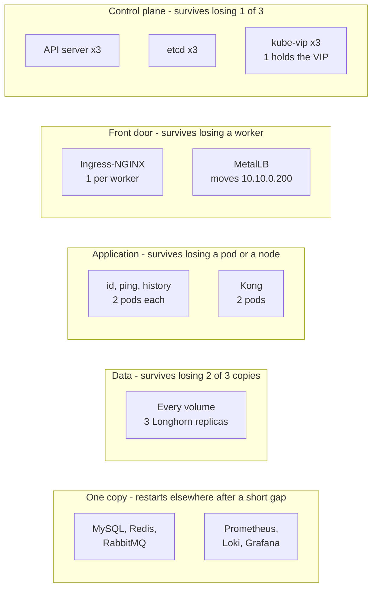
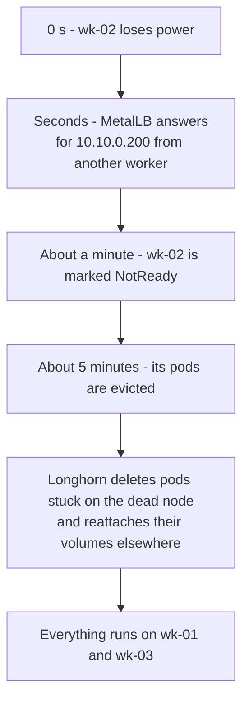
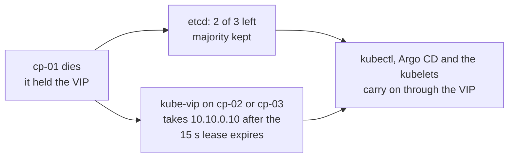
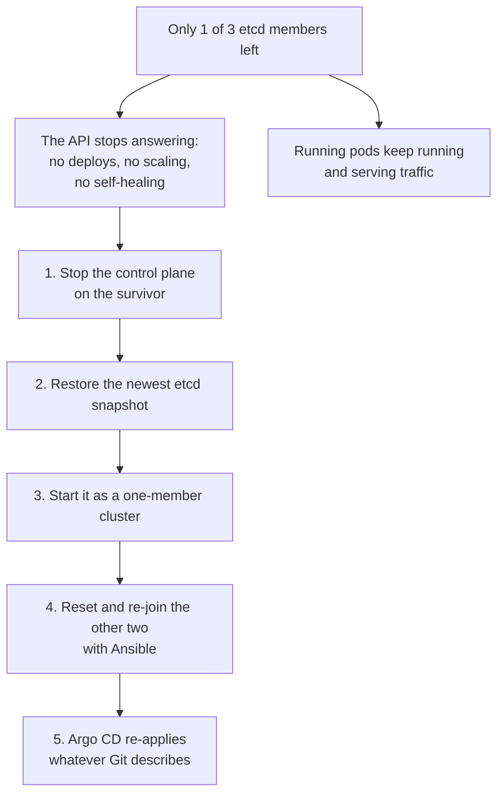
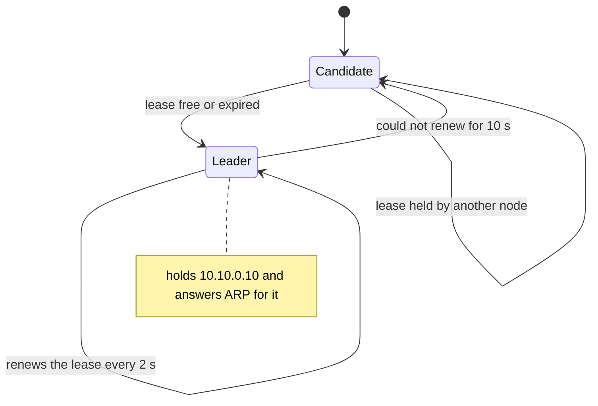
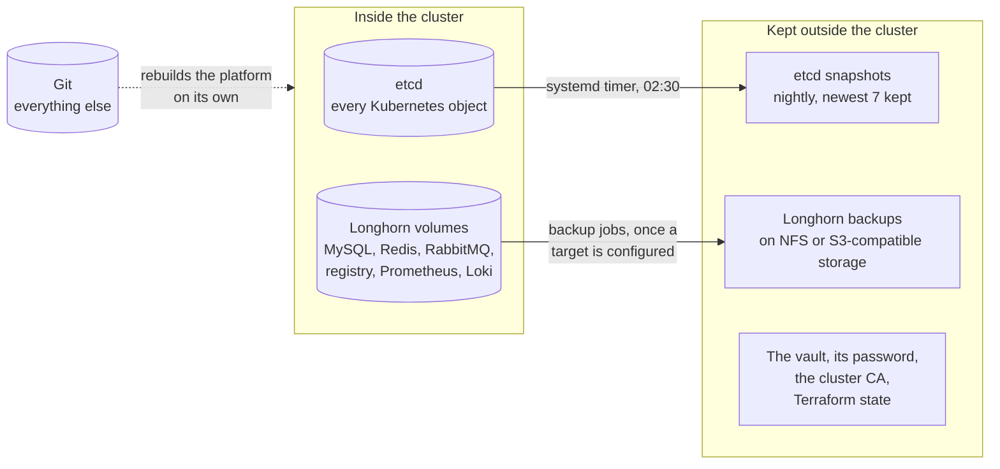
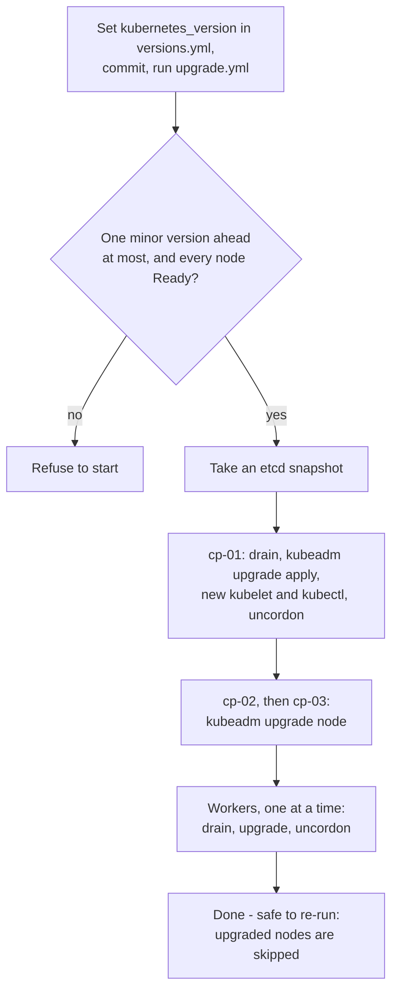

# 5 — Reliability and operations

[← Security](04-security.md) · Next: [Quality and CI →](06-quality-and-ci.md)

Two questions every DevOps interview gets to: **"What happens when something breaks?"** and **"How
do you run this day to day?"** This page answers both.

---

## What has a spare



| Component | Copies | When one fails |
|---|---|---|
| Control plane: API server, etcd, scheduler, controller manager | 3 | Nothing visible: two of three keep etcd's majority |
| Kubernetes API address (kube-vip) | 3 candidates, 1 active | Another control plane takes the VIP within ~15–20 s |
| Ingress-NGINX | 1 per worker | MetalLB announces 10.10.0.200 from another worker within seconds |
| GPS services and Kong | 2 each, on different workers where possible | The other pod carries the traffic; a disruption budget keeps one running during drains |
| Argo CD server and repo server, Cilium operator | 2 each | The other carries on |
| Every volume | 3 replicas on 3 workers | The volume keeps working from the remaining replicas |
| MySQL, Redis, RabbitMQ | 1 each | Restarts on another worker with its volume after about five minutes — stored data is kept, but [users notice while it's away](#while-a-data-store-is-away) |
| Prometheus, Loki, Grafana | 1 each | Same: restart elsewhere, data intact |
| Proxmox hosts | 2 or 3 | Depends on the layout — with two hosts, losing the one with two control planes stops the Kubernetes API ([page 10](10-proxmox-hosts.md)) |

### While a data store is away

The application depends on each store differently — worth knowing exactly:

| Store down | What users notice | What happens to the data |
|---|---|---|
| **Redis** | Location submissions and "who is near me?" queries fail | Kept: Redis writes an append-only file to its volume |
| **MySQL** | Sign-ups and logins fail, and so does every request once Kong's cached verdict for its token (at most 60 s old) runs out — id-service checks tokens against MySQL | history-service can't store batches: after three attempts each goes to the dead-letter queue, to be replayed later |
| **RabbitMQ** | Nothing — locations are still accepted and the latest positions updated | The history of those pings is lost: batches ping-service can't publish are dropped and counted |

> [!NOTE]
> **Be upfront about the single-copy data stores.** They trade minutes of disruption on a node
> failure for simplicity. The next step would be operators that run them clustered: MySQL InnoDB
> Cluster, Redis with Sentinel, RabbitMQ as a three-node cluster with quorum queues.

---

## Why three control planes: the quorum rule

etcd only accepts a write when a **majority** of its members agree. That keeps the data consistent,
but it means a cluster that lost its majority stops accepting changes.

| etcd members | Majority needed | Failures survived |
|---|---|---|
| 1 | 1 | 0 |
| 2 | 2 | **0** — worse than one: twice the machines that can fail |
| **3** | **2** | **1** |
| 4 | 3 | 1 — no better than three |
| 5 | 3 | 2 |

That's why Terraform refuses an even number of control planes.

---

## Failure scenarios

### A worker dies



- **The services keep answering** from their second pods on the other workers.
- **Unless wk-02 ran a data store.** Redis, MySQL and RabbitMQ have one copy each; whichever was on
  wk-02 is away until it restarts elsewhere, about five minutes in, with the effects in
  [the table above](#while-a-data-store-is-away).
- **Volumes run on two replicas** until wk-02 returns or is replaced; Longhorn then rebuilds the
  third copy — with one replica per worker, there's nowhere else to put it.
- **To replace it:** `kubectl delete node wk-02`, `terraform apply -replace=…`,
  `ansible-playbook site.yml --limit wk-02`.

### A control plane dies



The applications never notice: they don't talk to the API to serve traffic. To replace the node,
first remove its etcd member, then rebuild it with Terraform and Ansible.

### Two control planes die — quorum is lost



> **Interview soundbite:** *"Losing the control plane doesn't take the application down — the data
> plane keeps forwarding packets. What you lose is the ability to change anything. That's why
> etcd snapshots are taken nightly, and why restoring one is something to practise."*

### A Proxmox host dies

Every VM on it fails at once: a control plane or two, a worker or two. What survives depends on how
the VMs are spread — with two hosts, losing the one that holds two control planes stops the
Kubernetes API, while the other host's applications keep serving. With three hosts, any one can
fail. [Page 10](10-proxmox-hosts.md#what-a-host-failure-does) has the full picture.

### A disk fails

The replica on that disk is marked failed and the volume carries on from the other two. Longhorn
keeps each replica on a different worker, so with three workers the third copy is rebuilt only once
the disk is replaced. If every copy were lost, the volume would be restored from a Longhorn backup —
which needs a backup target configured first ([below](#backups-what-to-keep-and-what-you-dont-need-to)).

---

## How the API address moves: kube-vip



Every control plane runs kube-vip. They compete for one *lease* — a small object in Kubernetes. The
holder announces the VIP. If it stops renewing, the lease expires after 15 seconds and another
control plane takes over, announcing the address so the network learns its new location at once.

---

## Backups: what to keep, and what you don't need to



**The point to make:** everything in Git needs no backup — it *is* the backup. A lost cluster is
rebuilt with `terraform apply` and `ansible-playbook site.yml`, after which Argo CD redeploys every
application. Only three things must be kept elsewhere: **data** (volumes), **cluster state**
(etcd), and **secrets** (the vault and the CA's key).

> [!WARNING]
> Snapshots are written on the control planes themselves, and Longhorn backs nothing up until a
> backup target (an NFS share or S3-compatible bucket) is configured for the site. Until snapshots
> are copied off and a target exists, a lost cluster also loses its backups — the runbook makes
> copying snapshots a daily task.

---

## Upgrading Kubernetes



- **Control planes first**, because a kubelet may be older than the API server but never newer.
- **One minor version at a time** (1.36 → 1.37), as Kubernetes requires — the playbook refuses to
  skip one.
- **One node at a time**, drained first: the applications keep running on the others.
- **A safety net first**: the etcd snapshot taken before anything changes.

---

## Day 2: changing things

Nothing is changed by hand. Each kind of change has one place to edit and one command to apply it:

| To change | Edit | Apply with |
|---|---|---|
| Machines, addresses | `infra/terraform/terraform.tfvars` | `terraform apply`, then `ansible-playbook site.yml --limit <new nodes>` |
| Kubernetes version | `versions.yml` | `ansible-playbook upgrade.yml` |
| containerd, platform add-ons | `versions.yml` | `ansible-playbook site.yml --tags <layer>` |
| Monitoring, logging, registry, application | `deploy/kubernetes/…` | Merge to `main` — Argo CD applies it |
| A secret | the vault | `ansible-playbook site.yml --tags secrets` (or the layer that uses it); a MySQL password also needs an `ALTER USER` |

## Day 2: routine

| Task | How often |
|---|---|
| Watch alerts in Alertmanager and Grafana — nothing sends them anywhere until a receiver (e-mail, chat, pager) is configured. `Watchdog` always fires: it shows rules are evaluated and reach Alertmanager | Continuously |
| Copy etcd snapshots off the cluster | Daily |
| Check Kubernetes certificate expiry (`kubeadm certs check-expiration`) — every upgrade renews them | Monthly |
| Free registry space (`registry garbage-collect`) | Monthly |
| Reboot nodes for OS updates — one at a time, drained, Longhorn healthy before the next | Weekly, as needed |
| **Practise a restore** into a scratch cluster — an untested backup is only a hope | Quarterly |

**Rebooting a node safely:**

```bash
kubectl drain wk-01 --ignore-daemonsets --delete-emptydir-data
ssh ubuntu@10.10.0.21 sudo reboot
kubectl wait --for=condition=Ready node/wk-01 --timeout=10m
kubectl uncordon wk-01
kubectl -n longhorn-system get volumes.longhorn.io     # all healthy before the next worker
```

The full runbook, with recovery commands, is [10 — Operations](../on-prem/10-operations.md).

---

[← Security](04-security.md) · Next: [Quality and CI →](06-quality-and-ci.md)
