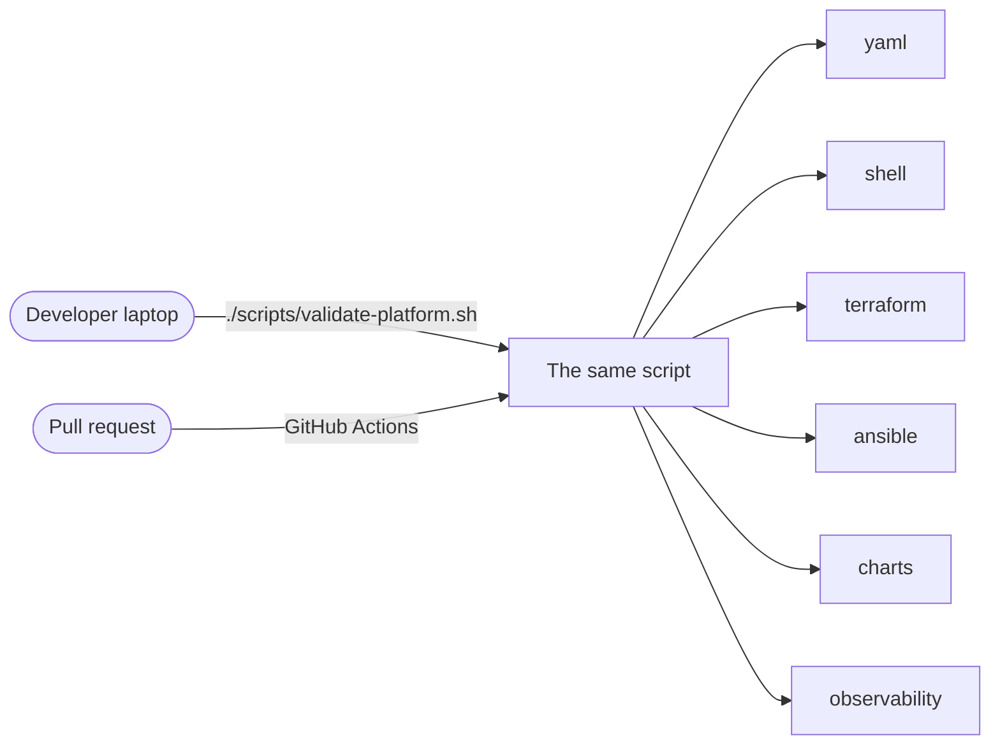
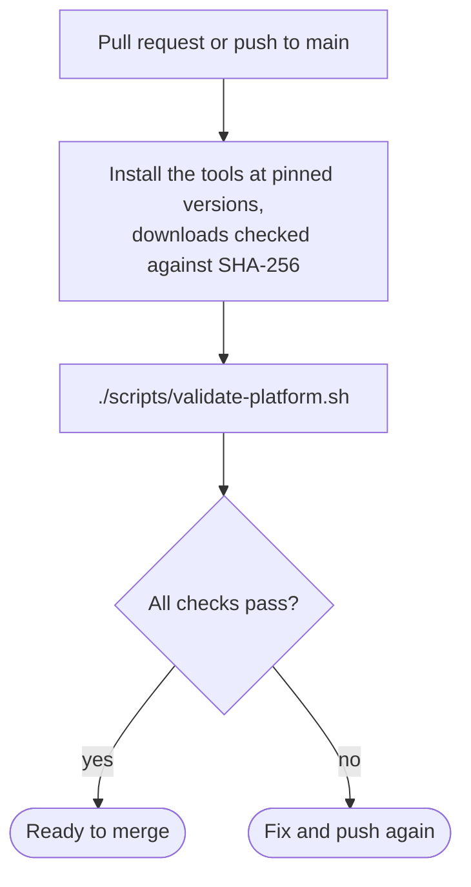

# 6 — Quality and CI

[← Reliability and operations](05-reliability-and-operations.md) · Next: [The presentation →](07-presentation.md)

**Infrastructure code is still code.** Most of its mistakes — a typo in a field name, an address
used twice, a broken alert query — can be caught before anything touches a server. This page shows
how.

---

## One script, run everywhere

The developer runs exactly what CI runs — no "works on my machine". Any subset works too:
`./scripts/validate-platform.sh charts observability`.

CI runs on every pull request, and every push to `main`, that touches `infra/`, `deploy/`,
`gateway/kong/` or `scripts/`. **Nothing in it needs a cluster**, so it takes minutes and costs
nothing.

---

## The six checks

| Check | What runs | What it catches |
|---|---|---|
| **yaml** | `yamllint` (strict) on Ansible, the charts and the workflows | Bad indentation, duplicate keys — YAML mistakes that change meaning silently |
| **shell** | `shellcheck` on every script | Unquoted variables, unused variables, portability bugs |
| **terraform** | `fmt -check`, `validate`, and a full **plan** of the example topology — with a dummy token and nothing contacted | Type errors, broken references, and every validation rule: an even number of control planes, duplicate IPs, the VIP colliding with a node |
| **ansible** | `--syntax-check` of both playbooks, `ansible-lint` on its strictest (production) profile, Python unit tests | Deprecated or mistyped modules, files without explicit permissions, commands that always report "changed" — and the logic tested below |
| **charts** | `helm lint`; then every Argo CD application is rendered **exactly as Argo CD would**, and `kubeconform` checks all 201 objects against the Kubernetes 1.36 schemas and the CRDs' schemas | A misspelt field, a wrong type, anything the API server would reject at deploy time |
| **observability** | `promtool check rules`, `alloy validate` | Broken PromQL in alerts **and in the dashboard** (each panel's query is checked as a recording rule), an invalid log pipeline |

---

## The CI pipeline

- **The CI's own tools are pinned** — ansible-core, ansible-lint, yamllint, shellcheck and Terraform
  to exact versions, and the four binaries it downloads (Helm, kubeconform, promtool, Alloy) checked
  against SHA-256 checksums. CI is part of the supply chain too. (Its helper Python libraries are
  not pinned yet.)
- **Read-only permissions** (`contents: read`): a compromised step can't push to the repository.
- **A newer push cancels the older run** on the same branch, so only the latest result matters.

---

## Testing the dangerous parts

Two pieces of Ansible logic have unit tests of their own, because a mistake there is expensive:

| Test | Why it exists |
|---|---|
| **The Longhorn disk guard** — feeds realistic `lsblk --json` output to the role's *own* safety conditions, read from the role file | Formatting a disk is the one operation in the repository that can't be undone. The test proves the guard accepts an empty disk, accepts its own disk on a re-run, and refuses the OS disk or anything holding data |
| **The address-range filter** — splits MetalLB's pool around the reserved ingress address | An off-by-one here hands the ingress address to another service. Tested at the first, last and middle address, across an octet boundary, and with bad input |

The application has its own tests too: unit tests for each service, integration tests against real
MySQL, Redis and RabbitMQ in containers (Testcontainers), and a test that reads Kong's `kong.yml` and
fails the build if any non-public route lacks authentication. `publish-images.sh` runs the unit
tests before it builds a release.

---

## Bugs caught before they reached a server

Good answers to *"tell me about a bug you found"*:

**1. The pull secret that would have failed the first real run.** Ansible "helpfully" turns a string
that looks like JSON back into a dictionary. The registry pull Secret's `.dockerconfigjson` would
have been written as a Python dictionary — not valid JSON — so the API server would have rejected
the Secret and the secrets step would have failed on the first run against a cluster. Ansible
can't run on the Windows workstation this was built on, so every template was rendered locally
instead — which is how it was caught. The template now serialises the value to JSON explicitly.

**2. The backslash that would have become a control character.** Ansible's Jinja decodes escape
sequences in string literals, so a regex backreference like `'\\1'` can silently turn into the
character `chr(1)`. The parsing of `kubeadm join` output was tested against the same Jinja version
first, and written with a capture group instead — no backslash to lose.

**3. Line endings from Windows.** The repository was developed on Windows; a systemd unit or shell
script checked out with Windows line endings fails on Linux with confusing errors. `.gitattributes`
now forces Unix line endings for everything that runs on the nodes.

**4. Addresses that would collide much later.** If the API's virtual IP were also given to a VM, the
symptom would be an API endpoint that flaps intermittently — weeks later, in production. Terraform
now refuses the plan instead.

---

## What validation can't catch — and the next step

| Not covered | Next step |
|---|---|
| Ansible's effect on real machines | Molecule tests for the roles, against throwaway VMs |
| The whole platform working together | A nightly job that builds a disposable cluster on Proxmox, runs `smoke-gateway.sh` and tears it down |
| The Java services in CI | A workflow running the Maven build with Testcontainers |
| Known vulnerabilities in images | An image scanner such as Trivy in the release script |

> **Interview soundbite:** *"Everything that can be checked without a cluster is checked on every
> pull request with the same script developers run — including rendering each Argo CD application
> exactly as Argo CD would and validating 201 objects against the 1.36 schemas. What it can't catch
> is real-machine behaviour, so the next step would be an ephemeral test cluster."*

---

[← Reliability and operations](05-reliability-and-operations.md) · Next: [The presentation →](07-presentation.md)
