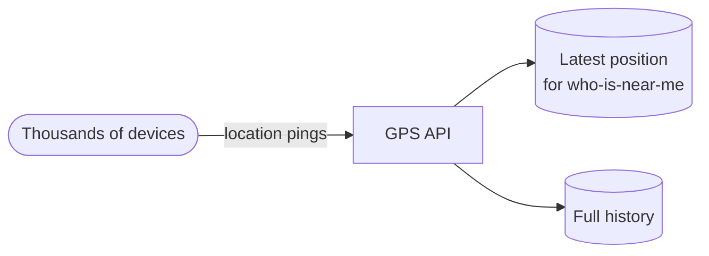
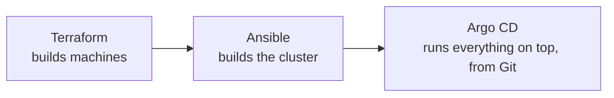
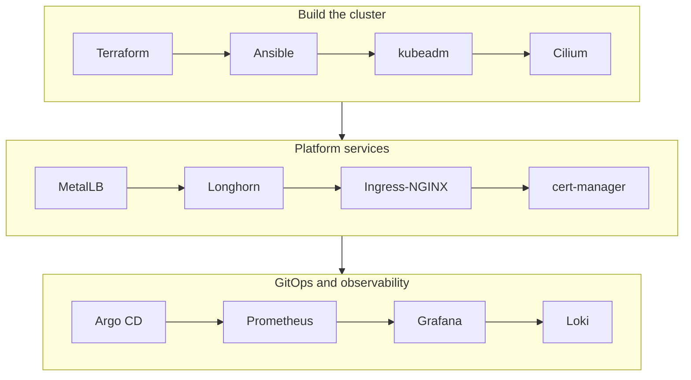
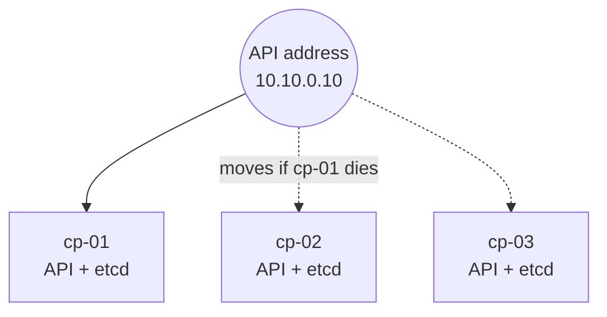
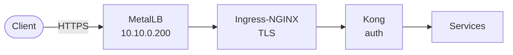
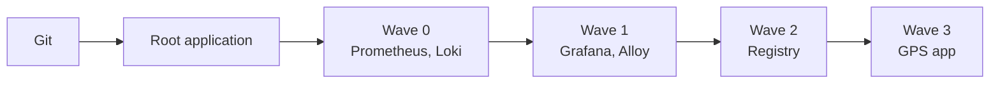
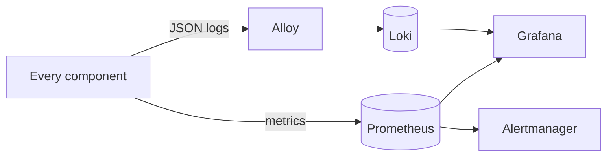
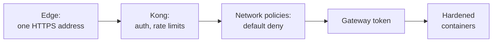
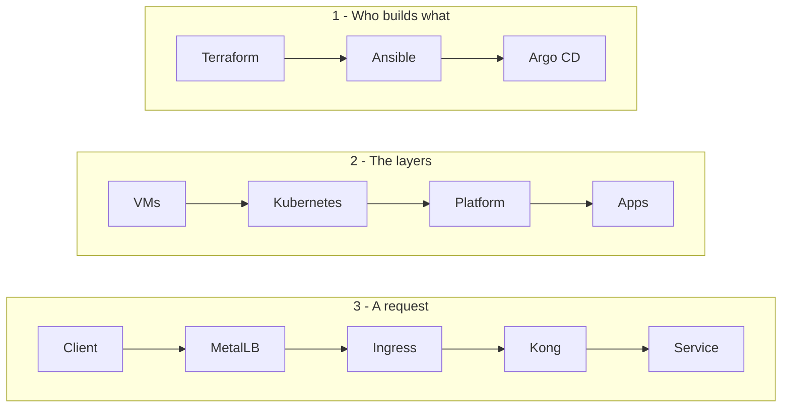

# 7 — The presentation

[← Quality and CI](06-quality-and-ci.md) · Next: [Interview questions →](08-interview-questions.md)

A 15-minute talk, slide by slide: what to show, the three points on the slide, and what to say.
Present it straight from GitHub — the diagrams render there — or copy the diagrams into slides.

| | |
|---|---|
| **Length** | 15 minutes, plus questions. A [5-minute version](#the-5-minute-version) is at the end |
| **Audience** | DevOps / platform engineers — they want decisions and trade-offs, not a tool list |
| **The thread** | *Everything is code, each layer stands on the one below, and every choice has a reason* |

## Timing

| # | Slide | Time | Running total |
|---|---|---|---|
| 1 | The title | 0:30 | 0:30 |
| 2 | The problem | 1:00 | 1:30 |
| 3 | The approach | 0:45 | 2:15 |
| 4 | The pipeline | 1:30 | 3:45 |
| 5 | A cluster that survives a failure | 1:30 | 5:15 |
| 6 | Getting traffic in | 1:30 | 6:45 |
| 7 | Storage and certificates | 1:00 | 7:45 |
| 8 | GitOps | 1:30 | 9:15 |
| 9 | Observability | 1:30 | 10:45 |
| 10 | Security | 1:00 | 11:45 |
| 11 | When things break | 1:00 | 12:45 |
| 12 | Quality | 0:45 | 13:30 |
| 13 | Lessons and next steps | 1:00 | 14:30 |
| 14 | Questions | — | |

---

## Slide 1 — The title

### A production-style Kubernetes platform, on hardware we own

- Realtime GPS tracking: Spring Boot microservices, Kong, MySQL, Redis, RabbitMQ
- Twelve tools, from bare virtual machines to dashboards
- Everything in one Git repository

> **Say:** "I'll show you how I took a microservices application from Docker Compose to a highly
> available Kubernetes platform on our own infrastructure — no cloud provider — and the decisions
> I made along the way."

---

## Slide 2 — The problem



- High write volume: thousands of devices reporting every few seconds
- Needs: high availability, durable data, security, visibility
- Constraint: **on-premises** — no managed Kubernetes, load balancers, storage or certificates

> **Say:** "In the cloud you get a load balancer, storage and certificates by clicking. On-premises,
> every one of those is a component you have to choose, install and operate. That's what this
> project is really about."

---

## Slide 3 — The approach



- Infrastructure as code, from the VMs up
- A clear hand-over: Ansible installs what Argo CD needs to run; Argo CD deploys the rest
- Rebuildable from scratch with three commands

> **Say:** "One sentence summarises the whole design: Terraform builds the machines, Ansible builds
> the cluster, and Git — through Argo CD — runs everything on top."

---

## Slide 4 — The pipeline



- Machines → operating system → cluster → network → platform services → GitOps → observability
- Each layer depends on the one before — the order is not arbitrary
- Versions pinned in one file; what the nodes download is verified against checksums

> **Say:** "Each tool solves exactly one problem the cloud would otherwise solve for you. Cilium is
> the network, MetalLB the load balancer, Longhorn the storage, cert-manager the certificate
> service. I'll go through the interesting decisions rather than every tool."

---

## Slide 5 — A cluster that survives a failure



- Three control planes: etcd needs a majority, so three survive one failure
- kube-vip gives the API one address that moves in ~15 seconds
- Join tokens are per node and expire in 15 minutes

> **Say:** "One problem here is a chicken-and-egg: the API needs its virtual IP before the cluster
> exists, so a load balancer inside the cluster can't provide it. kube-vip runs as a static pod and
> solves that. On Kubernetes 1.29 and later there's a second chicken-and-egg — kube-vip needs
> credentials that only start working after the API is up — so the first node bootstraps with the
> super-admin credentials and switches afterwards."

---

## Slide 6 — Getting traffic in



- **Cilium** replaces kube-proxy: Services in eBPF, network policies, flow visibility
- **MetalLB** gives the ingress a real address on our network; Cilium's own LB IPAM is off so they
  can't both hand out the same address
- **Ingress-NGINX** terminates TLS — it's archived, so it's locked down and the exit is planned

> **Say:** "Ingress-NGINX was archived this year. I kept it because it was part of the brief, but I
> treated it as a liability: the admission webhook that the IngressNightmare attacks used accepts
> only the API server, and the migration to Cilium's Gateway API is documented."

---

## Slide 7 — Storage and certificates

- **Longhorn**: three replicas of every volume, on three different workers
- The disk preparation refuses any disk that isn't empty — and that check has unit tests
- **cert-manager** runs an internal CA: every HTTPS name gets a certificate, renewed automatically,
  with no internet access needed

> **Say:** "Formatting a disk is the one thing in the repository you can't undo, so the guard in
> front of it is tested with real lsblk output — it refuses the OS disk and anything holding data."

---

## Slide 8 — GitOps



- App of apps: Ansible creates one application; it creates the rest from Git
- Sync waves: monitoring first, so the application is observed from its first pod
- A release is a commit; a rollback is `git revert`; manual changes are undone automatically

> **Say:** "Argo CD stopped assessing the health of Application objects years ago, which quietly
> weakens sync waves in an app of apps: a wave only waits for the previous one to be *created*. I
> restored the health check, so each wave waits until the previous one is actually healthy."

---

## Slide 9 — Observability



- The Prometheus CRDs are installed first, so every layer shipped its own ServiceMonitor
- Logs are JSON: one correlation id follows a request through every GPS service
- Alerts for the application: down, error rate, latency, queue backlog

> **Say:** "Here's how it pays off. Say history-service can't start after a password rotation: the
> alerts fire, the dashboard shows the queue growing while the API is fine, and the logs show MySQL
> refusing its login. Fix the password and it works through the backlog — nothing lost, because the
> queue absorbed the outage."

---

## Slide 10 — Security



- Defence in depth: each layer assumes the one before it failed
- Secrets in Ansible Vault — Git only names them
- Pinned versions and checksummed downloads

> **Say:** "A concrete example: if an attacker sends a forged user-id header, Kong deletes it before
> it authenticates. And if something inside the cluster calls a service directly, it fails twice —
> the network policy drops it, and it doesn't have the gateway token."

---

## Slide 11 — When things break

| Failure | Result |
|---|---|
| A worker | Pods move and volumes reattach; a data store that was on it is away for about five minutes |
| A control plane | Nothing visible — 2 of 3 keep quorum, the VIP moves |
| Two control planes | The app keeps serving; changes stop until etcd is restored from the nightly snapshot |
| A disk | Volumes continue from the other replicas |

> **Say:** "The interesting one is losing quorum: the application keeps serving traffic, because the
> data plane doesn't need the API. You just can't change anything until you restore etcd — which is
> why there are nightly snapshots and a written, practised procedure."

---

## Slide 12 — Quality

- One script validates everything, locally and in CI — no cluster needed
- Terraform plan, ansible-lint, and all 201 Kubernetes objects rendered as Argo CD would and checked
  against the 1.36 schemas
- Alert rules and dashboard queries checked with promtool

> **Say:** "It caught real bugs — for example, Ansible would have written the registry pull secret
> as a Python dictionary instead of JSON, and the API server would have rejected it on the first
> real run."

---

## Slide 13 — Lessons and next steps

**Lessons**
- On-premises, the bootstrapping order is the hard part — the cloud hides it
- Pin everything; check upstream before trusting what you remember (versions, deprecations)
- Write down the trade-offs — like the in-memory buffer, whose pings a hard kill loses

**Next steps**
- Clustered data stores; Gateway API instead of Ingress-NGINX
- Encryption of Secrets at rest, egress policies, single sign-on
- An ephemeral test cluster in CI

> **Say:** "If I did it again, I'd start with the ephemeral test cluster: static checks catch a lot,
> but only a real cluster proves the playbooks."

---

## Slide 14 — Questions

Keep [page 8](08-interview-questions.md) in mind. The most likely follow-ups, by slide:

| Slide | Likely question |
|---|---|
| 5 | "Why not k3s or RKE2?" · "What happens when etcd loses quorum?" |
| 6 | "Why Cilium?" · "Why do you need both MetalLB and Ingress-NGINX?" |
| 8 | "How do secrets work with GitOps?" · "How do you roll back?" |
| 9 | "What would you alert on?" |
| 11 | "How do you upgrade Kubernetes?" |

---

## The 5-minute version

1. **The problem (30 s)** — a GPS microservices platform, on our own hardware, with no cloud
   services.
2. **The design (1 min)** — Terraform builds the machines, Ansible builds the cluster and its
   foundations, Argo CD runs everything else from Git.
3. **Three decisions (2 min)** — kube-vip for the API address (chicken-and-egg); Cilium instead of
   kube-proxy, with MetalLB alone handing out addresses; sync waves with a restored health check,
   so monitoring is up before the application.
4. **Proof it's production-minded (1 min)** — recovers from a node failure by itself, nightly etcd
   snapshots, secrets never in Git, everything validated in CI.
5. **Next steps (30 s)** — clustered data stores, Gateway API, an ephemeral test cluster.

---

## Whiteboard version

If there's no screen, draw these three, in order — they carry the whole talk:



---

## Showing the code

No cluster needed — walk through the repository in this order (about 5 minutes):

| Show | Point to make |
|---|---|
| `infra/terraform/variables.tf` — the validations | "The plan refuses an even number of control planes or a duplicate IP" |
| `infra/ansible/site.yml` | "One play per layer, each with a tag; the order is the dependency order" |
| `infra/ansible/inventory/group_vars/all/versions.yml` | "Every version and checksum in one file" |
| `infra/ansible/roles/kubeadm_init/tasks/main.yml` | "The super-admin.conf switch for kube-vip" |
| `infra/ansible/roles/longhorn_node/tasks/main.yml` and its test | "The disk guard, and the test that proves it" |
| `deploy/kubernetes/gitops/templates/` | "One application per concern, sync waves in the annotations" |
| `deploy/kubernetes/gps/templates/network-policies.yaml` | "Default deny, one rule per real connection" |
| `scripts/validate-platform.sh` | "What CI runs — the same thing I run" |

With a running cluster, add:

```bash
kubectl get nodes -o wide                      # 3 control planes, 3 workers, all Ready
kubectl -n argocd get applications             # everything Synced and Healthy
kubectl -n kube-system exec ds/cilium -c cilium-agent -- cilium-dbg status | grep KubeProxyReplacement
kubectl -n gps get pods -l app.kubernetes.io/name=ping-service
kubectl -n gps delete pod <one of the two>     # the other keeps serving
kubectl -n gps get pods -w                     # a replacement is Ready within a minute
```

---

## Presenting tips

- **Lead with the why.** "I needed X, so I chose Y over Z because…" beats "I used Y."
- **Name the trade-offs yourself** — the single-copy data stores, the in-memory buffer, the archived
  ingress. It shows judgement, and takes the sting out of the question.
- **Have numbers ready** — 6 VMs, 3 replicas, 15-second VIP failover, 5 sync waves, 201 validated
  objects, 0 secrets in Git.
- **If you don't know, say how you'd find out** — "I'd check the Cilium compatibility matrix
  first" is a good answer.

---

[← Quality and CI](06-quality-and-ci.md) · Next: [Interview questions →](08-interview-questions.md)
