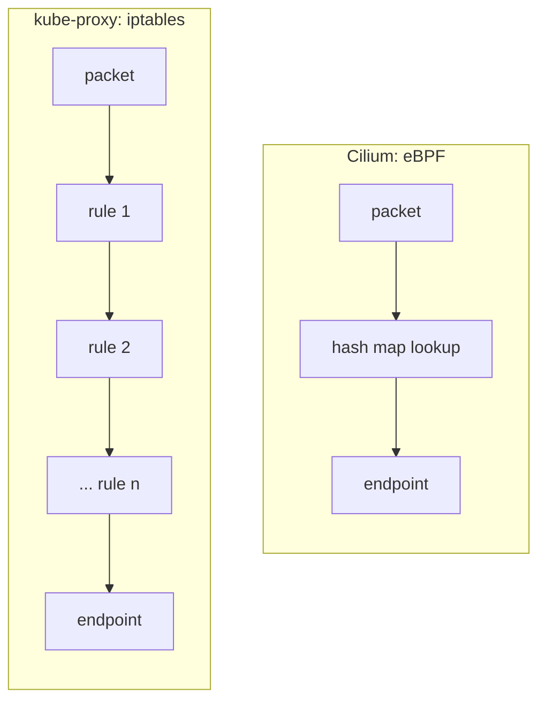
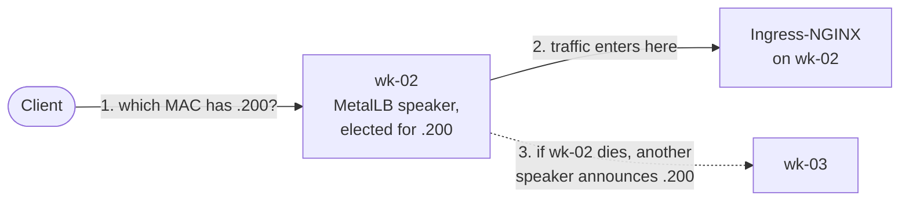
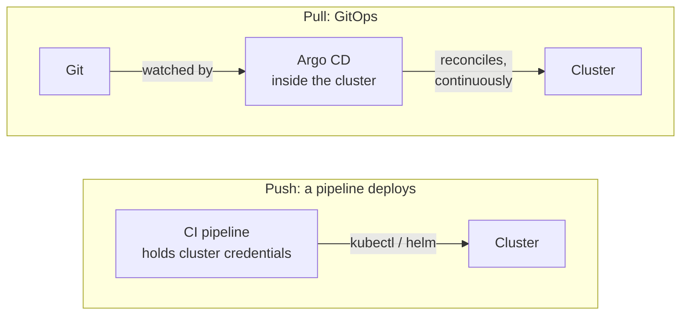

# 8 — Interview questions

[← The presentation](07-presentation.md) · Next: [Glossary →](09-glossary.md)

77 questions an interviewer is likely to ask about this platform, each answered from what was
actually built.

> [!TIP]
> **How to practise:** read a question, answer it out loud, *then* click it to compare. A good answer
> has three parts — **what** it is, **what you did** here, and **why** (the trade-off).

| Section | Questions |
|---|---|
| [The big picture](#the-big-picture) | 1–6 |
| [Terraform](#terraform) | 7–11 |
| [Ansible](#ansible) | 12–17 |
| [Kubernetes and kubeadm](#kubernetes-and-kubeadm) | 18–26 |
| [Networking](#networking) | 27–35 |
| [Storage](#storage) | 36–40 |
| [Certificates](#certificates) | 41–43 |
| [GitOps](#gitops) | 44–50 |
| [Observability](#observability) | 51–56 |
| [Security](#security) | 57–62 |
| [Reliability and operations](#reliability-and-operations) | 63–68 |
| [The application](#the-application) | 69–73 |
| [About you and your choices](#about-you-and-your-choices) | 74–77 |

---

## The big picture

<b>1. Walk me through the platform in two minutes.</b>

Terraform creates six VMs on Proxmox — three control planes, three workers — and writes the Ansible
inventory. Ansible prepares the nodes (kernel settings, containerd, Kubernetes packages), creates a
highly available cluster with kubeadm behind a kube-vip virtual IP, and installs the platform
layers: Cilium for networking, MetalLB for load-balancer addresses, Longhorn for replicated storage,
Ingress-NGINX as the front door, and cert-manager as an internal CA. It writes the secrets from
Ansible Vault and installs Argo CD. From there Argo CD deploys everything else from Git in sync
waves: Prometheus and Loki, then Grafana and Alloy, then the image registry, then — once its
first release is published — the GPS application. A CI pipeline validates all of it without a
cluster.

<b>2. Why on-premises rather than a managed cloud service?</b>

Typical reasons: location data is personal data, so **data sovereignty** and regulation; predictable
**cost** at a steady, high load; **latency** to devices in one region; existing hardware; no vendor
lock-in. The trade-off is that you operate everything a cloud would give you — load balancers,
storage, certificates — and that is precisely what the platform provides.

<b>3. Why split the work between Ansible and Argo CD?</b>

It's a design choice. Some layers need work on the nodes themselves — Longhorn's disks, trusting the
cluster CA — which is Ansible's job anyway. The rest are what Argo CD runs on and is reached
through: the pod network, the ingress, the certificates. Kept out of Argo CD, a bad sync can never
break what Argo CD would need to repair it. (Many teams do let Argo CD manage MetalLB or
cert-manager; it works, with that risk.) Everything above lives in Git, where it gets review,
history, drift correction and rollback by `git revert`. Secrets are the exception: they are always
written by Ansible, from the vault, and Git only refers to them by name.

<b>4. What does "infrastructure as code" buy you here, concretely?</b>

The whole platform can be rebuilt from scratch with three commands; every change is a reviewed
commit; mistakes are caught in CI before they reach a machine; and the repository *is* the
documentation of what runs. Disaster recovery becomes "re-run the code, restore the data".

<b>5. What was the hardest part?</b>

The bootstrapping order — the chicken-and-egg problems a cloud hides from you. The API needs its
virtual IP before the cluster exists (kube-vip as a static pod). kube-vip needs credentials that
only work once the API is up (`super-admin.conf` on the first node). Charts that ship
ServiceMonitors need the Prometheus CRDs first. Argo CD shouldn't manage what it runs on. And the
app-of-apps sync waves needed a health check Argo CD no longer ships.

<b>6. What would you do differently next time?</b>

Build an ephemeral test cluster into CI from day one — static checks catch a lot, but only a real
cluster proves the playbooks. Start on the Gateway API instead of Ingress-NGINX. Run the data stores
clustered through operators. Use a secrets manager with the External Secrets Operator for rotation.

---

## Terraform

<b>7. Why Terraform for the VMs, rather than Ansible's Proxmox modules?</b>

Terraform is **declarative with state**: it knows what it created, shows a plan before changing
anything, and can replace or destroy exactly those resources. Its variable validations and
preconditions reject a bad topology before anything is built. Ansible is better at configuring the
inside of machines — so each tool does what it is best at.

<b>8. What is in the Terraform state, and how would you manage it in a team?</b>

The mapping between the code and real resources (VM ids, disks, addresses), which can include
sensitive values. Here it is local, for a single operator. In a team: a shared backend with locking
that also lives on-premises — `versions.tf` sketches PostgreSQL's `pg` backend — with restricted
access, so two people can't apply at once and the state never sits on a laptop.

<b>9. How do you stop Terraform from causing an outage?</b>

`allow_vm_reboot = false` by default: some changes (CPU, memory) need a VM reboot, and the provider
would otherwise reboot a node by itself. Such a change now fails until the node is drained and the
apply is repeated with the flag set. Plans are reviewed, and `-replace` is always a deliberate,
targeted command.

<b>10. How does Ansible know which machines exist?</b>

Terraform generates `inventory/hosts.yml`: the control plane and worker groups, each node's address,
the API VIP, the MetalLB pool, the ingress IP, and each worker's data disk by its stable
`/dev/disk/by-id/...` path. Nobody maintains a list of IPs by hand.

<b>11. What does Terraform validate before creating anything?</b>

An odd number of control planes (for etcd quorum), at least one worker, unique IPs and VM ids, a
data disk on every worker, a valid network CIDR, at least one SSH key (the VMs have no password
login) — and a precondition that the API VIP and ingress IP collide with no node and not with each
other.

---

## Ansible

<b>12. What does idempotent mean, and how did you make the playbooks idempotent?</b>

Running it again changes nothing if nothing needs changing. Modules declare a state rather than an
action; `kubeadm init` and `join` are guarded by the files they create; commands declare when they
changed something (`changed_when`). Manifests go through a small role that runs `kubectl diff`
first and only applies — server-side — when there is a difference, so the run reports changes
truthfully. `ansible-lint`'s production profile enforces much of this.

<b>13. How do you handle secrets in Ansible?</b>

One vars file encrypted with Ansible Vault, git-ignored; `vault.example.yml` documents each secret
and how to generate it. Runs use `--ask-vault-pass`, and every task that touches a secret has
`no_log: true`, so values never appear in output or CI logs. Ansible writes them into Kubernetes
Secrets that applications reference by name.

<b>14. Why install containerd from its upstream release rather than apt?</b>

To get an **exact, pinned version** on every node, verified against a SHA-256 checksum in the
repository — the distribution's package follows its own version and patch schedule. The
configuration is generated too: systemd cgroups, the pinned pause image, and registry mirrors for
sites without internet access.

<b>15. Why must containerd use the systemd cgroup driver?</b>

The kubelet and the container runtime must agree on the cgroup driver. On a systemd host — Ubuntu
24.04 with cgroup v2 — kubeadm configures the kubelet for systemd, so containerd must use
`SystemdCgroup = true`. A mismatch leaves two managers fighting over the same resources, which shows
up as unstable nodes under pressure.

<b>16. How do you prevent an accidental Kubernetes upgrade?</b>

The packages are held, so `apt upgrade` can't move them. A version guard refuses to change the
version on a node that has already joined, pointing to `upgrade.yml` instead. And `upgrade.yml`
refuses to jump more than one minor version.

<b>17. Could this run without internet access?</b>

Mostly by design. Everything Ansible uses — Helm chart repositories, binary download locations,
container registry mirrors — is a variable, so it can point at internal mirrors such as Harbor or
Nexus. The Git repository Argo CD reads is a variable too: an internal Git server mirroring this
one. The applications Argo CD deploys name their upstream Helm repositories in the gitops chart, so
those few URLs would be changed there, in Git.

---

## Kubernetes and kubeadm

<b>18. Why kubeadm rather than k3s, RKE2 or Talos?</b>

kubeadm builds upstream Kubernetes with no vendor layer, and gives full control of every
component — the Kubernetes most interviews and the CKA are about. The others are excellent and
simpler to run: k3s for edge and small clusters, RKE2 for hardened defaults, Talos for an immutable
OS. The trade-off is more to operate yourself, which this project wanted to show.

<b>19. What runs on a control plane node?</b>

As static pods from `/etc/kubernetes/manifests`: kube-apiserver, etcd, kube-scheduler,
kube-controller-manager — and here kube-vip. Plus the kubelet and containerd as system services,
and the Cilium agent as a DaemonSet pod.

<b>20. Stacked or external etcd — which and why?</b>

Stacked: etcd runs on the control planes. Fewer machines and simpler, at the cost of a shared failure
domain — losing a control plane also loses an etcd member. External etcd isolates it on its own
machines. Three stacked members is kubeadm's standard HA topology and fits this size.

<b>21. What is kube-vip, and why not use MetalLB for the API address too?</b>

kube-vip runs as a static pod on each control plane; the instances elect a leader through a
Kubernetes Lease, and the leader answers ARP for `10.10.0.10`. MetalLB runs as ordinary pods
*inside* the cluster, so it can't provide the address the cluster needs before it exists. kube-vip
for the API, MetalLB for services.

<b>22. Explain the super-admin.conf problem.</b>

Since Kubernetes 1.29, `admin.conf` gets its rights from a ClusterRoleBinding that `kubeadm init`
creates — so it can't do anything until the API is up. But on the first node, kube-vip has to hold its leader
lease to bring the VIP up, and the API is reached through the VIP. So kube-vip starts with
`super-admin.conf` (which bypasses RBAC) during init, and the playbook switches it to `admin.conf`
right after.

<b>23. How does a new node join securely?</b>

With a bootstrap token created just for it, valid for 15 minutes, so the cluster can trust the node;
and a hash of the cluster CA's public key, so the node can trust the cluster — no
man-in-the-middle. The kubelet then gets its own client certificate. A new control plane also
receives the cluster's keys, encrypted with a one-time key, from a Secret kubeadm deletes after two
hours.

<b>24. What happens to running pods if the API server goes down completely?</b>

They keep running and serving: the kubelet keeps the containers up and Cilium keeps forwarding. What
stops is everything that needs the API — scheduling, scaling, self-healing, deployments.

<b>25. How do you upgrade the cluster?</b>

`upgrade.yml`: it checks the target is at most one minor version ahead and every node is Ready, takes
an etcd snapshot, then upgrades one node at a time — control planes first (`kubeadm upgrade apply` on
the first, `upgrade node` on the others), then workers — draining each, upgrading kubeadm, the
kubelet and kubectl, and uncordoning it. Control planes go first because a kubelet may be older than
the API server but never newer.

<b>26. How are kubeadm's certificates renewed?</b>

They last a year and every `kubeadm upgrade` renews them, so regular upgrades handle it. A monthly
`kubeadm certs check-expiration` is in the runbook, and if they did expire: `kubeadm certs renew all`
on each control plane and restart the static pods.

---

## Networking

**Two diagrams that help in this section:**

<b>27. What is a CNI, and what does Cilium do here?</b>

A CNI plugin gives each pod its network interface and address and connects pods across nodes. Cilium
does that, and also replaces kube-proxy, enforces network policies (including Cilium's own richer
ones), and provides Hubble for seeing every flow.

<b>28. What does "kube-proxy replacement" mean, and why do it?</b>

kube-proxy implements Services with iptables rules, which are evaluated in sequence and rewritten as
a whole — slow at scale. Cilium implements Services with eBPF hash-map lookups in the kernel: constant
time, no rule chains, one less component. Without kube-proxy, the Cilium agents can't reach the API
through its Service at start-up, so they're given the VIP directly.

<b>29. Native routing or tunnelling — what did you choose?</b>

Native routing: pod packets travel between nodes unencapsulated, with a route per node's pod range.
No VXLAN overhead and a full MTU. It needs the nodes on one network segment, which Terraform's
address plan guarantees. Tunnelling would be the choice for nodes across routed subnets.

<b>30. How do pods get their IP addresses?</b>

Cilium's IPAM is in `kubernetes` mode: kube-controller-manager gives each node a slice of
`10.244.0.0/16` (kubeadm's `podSubnet`), and Cilium assigns pod addresses from its node's slice.
One source of truth for the pod network.

<b>31. Why do you need MetalLB if you already have an ingress controller?</b>

They work at different layers. The ingress controller is pods behind a `LoadBalancer` Service —
something has to give that Service an address reachable from outside. In a cloud, the cloud's load
balancer does; on-premises, MetalLB does. MetalLB provides the address (layer 4); Ingress-NGINX
routes HTTP by host name (layer 7).

<b>32. How does MetalLB's Layer 2 mode work, and what are its limits?</b>

For each address one node is elected to answer ARP, so all traffic for that address enters through
that node; when the node fails, another announces the address within seconds. Limits: one node's
bandwidth per address, not true load balancing, and failover takes seconds. BGP mode spreads traffic
across nodes, but needs routers that speak BGP.

<b>33. What is externalTrafficPolicy: Local, and why use it?</b>

Traffic is only delivered to pods on the node where it arrived — no second hop, and no source NAT,
so the **real client address** is preserved. MetalLB then only announces from nodes with a ready
pod; Ingress-NGINX runs on every worker, so every worker qualifies. The real address is what makes
per-client rate limiting in Kong meaningful.

<b>34. Ingress-NGINX is retired. What would you do?</b>

Move to the Gateway API, the successor to Ingress. Cilium is already installed and implements it
once its Gateway API support is switched on and the Gateway API CRDs are added. Then, host by host:
create a Gateway with the same certificates, an HTTPRoute per Ingress, test, then move the address.
Until then: the admission webhook only accepts the API server, snippet annotations are off, and the
exposure is minimal.

<b>35. How would you debug "service A can't reach service B"?</b>

From the bottom up: are B's pods ready and in its EndpointSlice? Does DNS resolve from A's pod? Is a
network policy dropping it — `hubble observe --namespace gps --verdict DROPPED` names the exact flow
and policy. Is Cilium healthy (`cilium-dbg status`)? Then the application logs. Hubble turns
network debugging from guesswork into a lookup.

---

## Storage

<b>36. How does Longhorn work?</b>

Each volume has an engine on the node where its pod runs, and replicas on different nodes. Every
write goes synchronously to all replicas. The volume reaches the pod's node as a block device over
iSCSI, and the CSI driver ties it to PersistentVolumeClaims.

<b>37. Why three replicas, and what capacity does that leave?</b>

One replica per worker means a volume survives losing two of them. The cost is that usable space is
about one disk's worth: three 200 GiB disks, minus a small reservation, and Longhorn stops placing
replicas once a disk has less than 25 % free — roughly 150 GiB of volumes.

<b>38. What happens to a volume when its node dies?</b>

The pod using it would hang in `Terminating`; Longhorn's node-down policy deletes it so it can start
on another worker, where the volume attaches from the surviving replicas. The volume runs degraded
until the node comes back or is replaced: Longhorn keeps each replica on a different worker, and
with three workers there's nowhere else to rebuild the third.

<b>39. Longhorn, Rook/Ceph, or local volumes?</b>

Ceph does block, file and object storage at large scale, but is much more to operate. Local volumes
are the fastest, but don't replicate — the application must. Longhorn is simple, replicated block
storage with backups to NFS or S3: the right size for this cluster.

<b>40. What does a node need before Longhorn can use it?</b>

`open-iscsi` with `iscsid` running, `nfs-common` for shared volumes, the `iscsi_tcp` and `dm_crypt`
kernel modules, and a mounted data disk. One subtle one: `multipathd` is told to ignore these disks,
otherwise it grabs Longhorn's devices and volumes fail to mount with "already mounted or mount point
busy".

---

## Certificates

<b>41. Why an internal CA instead of Let's Encrypt?</b>

ACME needs either an HTTP challenge reachable from the internet or a DNS challenge on a public zone.
An on-premises cluster with `.internal` names has neither. cert-manager's CA issuer works offline.
An organisation with its own PKI can plug in an intermediate from its enterprise CA instead.

<b>42. How do clients come to trust your certificates?</b>

The root CA certificate is distributed once: Ansible installs it on every node (so containerd trusts
the registry), and workstations import it — the TLS guide shows how per OS. Everything it signs is
then trusted.

<b>43. What happens when a certificate expires?</b>

It doesn't get the chance: cert-manager renews each certificate well before expiry. The root CA lasts
ten years and its key is never rotated, so renewals never break trust. Kubernetes' own certificates
are separate — kubeadm's, one year, renewed by every upgrade.

---

## GitOps

<b>44. What is GitOps?</b>

The desired state of the cluster is declared in Git; an agent inside the cluster continuously
compares it with reality and reconciles any difference. Changes go through pull requests, Git's
history is the audit trail, and drift is corrected automatically.

<b>45. Push-based deployment or pull-based — what's the difference?</b>

In push, a CI pipeline runs `kubectl` or `helm` — it needs cluster credentials, and the cluster is
only correct at the moment of deployment. In pull, the agent in the cluster fetches from Git: the
credentials never leave the cluster and the state is reconciled continuously. The cost is one more
component to run, and a separate answer for secrets.

<b>46. What is the app-of-apps pattern?</b>

One root Application points at a chart whose templates are Applications — here monitoring, logging,
the registry and the GPS app. Ansible creates only the root; Argo CD creates the rest. The
alternative is ApplicationSets, which generate applications from a template — useful at many
clusters or environments.

<b>47. What are sync waves, and why did you need a custom health check?</b>

An annotation that orders resources in a sync: Argo CD applies wave 0, waits for it to be healthy,
then wave 1, and so on. But since Argo CD 1.8, Application resources have no health assessment of
their own, so a child application counts as healthy as soon as it is created — the waves wouldn't
wait. A small Lua health check in Argo CD's configuration restores it.

<b>48. How do you handle secrets with GitOps?</b>

Here, Ansible writes Secrets from the vault and Git only names them. The alternatives: Sealed Secrets
(encrypted Secrets committed to Git), SOPS (encrypted files decrypted by Argo CD), or the External
Secrets Operator pulling from HashiCorp Vault — the best fit for rotation at scale.

<b>49. How do you roll back a bad release?</b>

`git revert` the commit that changed the image tag; Argo CD syncs the previous version. Argo CD has a
rollback button of its own, but it refuses to roll back an application with automated sync turned
on — and rightly: Git is the source of truth, so the rollback happens in Git.

<b>50. What happens if someone changes a managed resource with kubectl edit?</b>

Automated sync has `selfHeal` on: Argo CD sees the drift and puts back what Git says. With `prune`
on, removing something from Git removes it from the cluster. Every application the root one creates
also retries a failed sync with back-off.

---

## Observability

<b>51. Metrics, logs and traces — what's the difference?</b>

Metrics are numbers over time — cheap, ideal for dashboards and alerts (Prometheus). Logs are
individual events with detail — the *why* (Loki). Traces follow one request across services with
timings. This platform has metrics and logs, plus a correlation id in the GPS services' log lines;
distributed tracing with OpenTelemetry and Tempo would be the next step.

<b>52. How does Prometheus know what to scrape?</b>

The Prometheus Operator watches `ServiceMonitor` and `PodMonitor` objects, and Prometheus is set to
select all of them in every namespace. Each chart ships its own ServiceMonitor, so a new component
is monitored as soon as it is installed.

<b>53. Why install the Prometheus CRDs before everything else?</b>

A chart that ships a ServiceMonitor fails if the CRD doesn't exist yet. Installing the CRDs right
after the cluster — from Ansible, matched to the operator's version — let every layer turn
monitoring on from day one. When Prometheus arrived, it was already monitoring the whole platform.

<b>54. How is Loki different from Elasticsearch?</b>

Loki indexes only a few labels — namespace, pod, container, app, node — and stores the log lines
compressed; a query selects streams by label, then filters the text. Elasticsearch indexes every
word: more powerful search, much heavier to run. With Loki, keep labels low-cardinality — which is
why the per-file label is dropped.

<b>55. What would you alert on?</b>

What users feel, and what predicts it: error rate and latency (`GpsHighErrorRate` above 5 %,
`GpsSlowRequests` p95 above one second), components down (`GpsComponentDown`), and saturation
before it hurts (`GpsLocationQueueBacklog`). Plus kube-prometheus-stack's rules for the cluster.
Honestly, the next step is routing: Alertmanager has no receivers yet, so alerts are only visible in
its UI and Grafana until e-mail, chat or a pager is configured — with `Watchdog`, which always
fires, sent to a dead man's switch that raises the alarm if it ever stops arriving.

<b>56. How do you know your alert rules are correct?</b>

`promtool check rules` runs in CI on every change. The dashboard's PromQL is checked the same way,
by turning each panel's query into a recording rule. In the cluster, the always-firing `Watchdog`
shows rules are being evaluated and reaching Alertmanager.

---

## Security

<b>57. How do you secure traffic between services?</b>

A default-deny network policy in the application namespace with one allow rule per real
connection; a gateway token that every service checks; non-root, hardened containers. Traffic inside
the cluster is plain HTTP today, so the next step is encrypting it — Cilium's transparent WireGuard
encryption, or mutual TLS through a service mesh.

<b>58. How would you protect Secrets stored in etcd?</b>

Today they're stored unencrypted in etcd — base64 is an encoding, not encryption. A known gap. The
fix is an `EncryptionConfiguration` on the API server (`secretbox` or `aescbc`, or a KMS v2 provider
backed by HashiCorp Vault or an HSM), plus RBAC that limits who can read Secrets, and protecting
etcd snapshots, which contain them all.

<b>59. What is Pod Security Admission?</b>

A built-in admission controller that enforces the Pod Security Standards — privileged, baseline,
restricted — per namespace, through labels. It replaced PodSecurityPolicy, removed in 1.25. The GPS
services already meet the restricted profile. Kong needs non-root enforced (`runAsNonRoot`), and the
data stores need the full set of settings, before the `gps` namespace can be labelled to enforce it.

<b>60. How do you protect the software supply chain?</b>

Every version pinned; the binaries the nodes and CI download verified against checksums stored in
Git; application images built from source into our own registry. Not everything is airtight: the
services' Java base image follows the newest Java 21 patch, and CI's helper Python libraries aren't
pinned. Next: pin those, reference images by digest, sign them with cosign, scan them with Trivy,
and verify signatures at admission with Kyverno.

<b>61. How does the API gateway protect the services?</b>

Kong deletes identity headers a client could forge, authenticates every protected route through
the `rls_auth` plugin (caching each verdict for at most 60 seconds), rate-limits — 600 requests a
minute per client, 10 on the token endpoint, each counted by every Kong replica on its own — and has
its Admin API switched off. A build-time test fails if any non-public route lacks authentication.

<b>62. Give examples of least privilege in this project.</b>

Join tokens per node that expire in 15 minutes; `super-admin.conf` only during bootstrap; services as
non-root with no capabilities; CI with a read-only token; the Ingress-NGINX webhook reachable only by
the API server; Longhorn's and the registry's ports open only to what needs them.

---

## Reliability and operations

<b>63. What is your backup strategy?</b>

Nightly etcd snapshots on each control plane, the newest seven kept, copied off daily. Longhorn
backups to storage outside the cluster — an NFS share or S3-compatible bucket, configured per site.
The vault, its password, the CA and the Terraform state stored safely. Everything else is in Git and
needs no backup. And a quarterly restore drill — an untested backup is only a hope.

<b>64. How do you patch and reboot nodes safely?</b>

One at a time: drain (which respects PodDisruptionBudgets), reboot, wait until the node is Ready,
uncordon — and wait for every Longhorn volume to be healthy again before touching the next node.

<b>65. How would you scale the cluster?</b>

Add a worker to `terraform.tfvars`, `terraform apply`, then `ansible-playbook site.yml --limit` the
new node; MetalLB, Cilium and Longhorn pick it up automatically. Control planes go from three to five
— always an odd number.

<b>66. What SLO would you set for this system?</b>

For example: 99.9 % of location submissions answered successfully within 500 ms, over 30 days —
measured from Kong's and the services' request metrics. That leaves an error budget of about 43
minutes a month; when it runs low, reliability work takes priority over features.

<b>67. How do you know your backups work?</b>

By restoring them. The runbook has a quarterly drill: restore an etcd snapshot and a Longhorn backup
into a scratch cluster and check the result.

<b>68. What happens during a node drain?</b>

The node is cordoned so nothing new lands there; then its pods are evicted, respecting
PodDisruptionBudgets — each service keeps at least one pod running. DaemonSet pods stay. Evicted
pods shut down gracefully and start on other nodes.

---

## The application

<b>69. Why put Kong behind Ingress-NGINX — isn't that two gateways?</b>

They do different jobs. Ingress-NGINX is the cluster's front door for every host — TLS and routing
for the UIs and the API. Kong is the application's gateway — the custom `rls_auth` plugin, header
stripping, per-route rate limits. Keeping Kong means the application's security model is identical
in Docker Compose and on Kubernetes.

<b>70. Why did you drop Consul on Kubernetes?</b>

Kubernetes already provides service discovery (DNS) and configuration (ConfigMaps and Secrets). The
services treat Consul as optional, so it is switched off with one environment variable — no code
change. Docker Compose still uses it.

<b>71. How do services shut down without dropping requests?</b>

A `preStop` pause of five seconds lets the Service and Kong stop sending traffic first; Spring then
shuts down gracefully, finishing requests in flight; the termination grace period of 40 seconds
covers both. On shutdown the ping service also drains its in-memory buffer to RabbitMQ.

<b>72. Why is the location write path asynchronous?</b>

Throughput and resilience. The device gets its answer once Redis has the newest position; the full
history is published in batches and written by history-service at its own pace. RabbitMQ absorbs
spikes, and history-service being down: batches wait in the durable queue. If MySQL itself is down,
history-service parks the batches it can't store in a dead-letter queue, for replay. Delivery is
at-least-once, so the insert is idempotent.

<b>73. How do you run stateful services safely on Kubernetes?</b>

StatefulSets with volumes on three-way-replicated Longhorn storage, probes, and resource limits.
Details matter: Redis's `maxmemory` sits below its container limit with `noeviction`, so it refuses
writes instead of being killed for using too much memory; MySQL's users are created on first start
with passwords from the vault.

---

## About you and your choices

<b>74. Tell me about a bug you found.</b>

Ansible "helpfully" turns a string that looks like JSON back into a dictionary, so the registry pull
Secret would have been written as a Python dictionary instead of JSON — the API server would have
rejected it, and the first real run would have failed. Ansible can't run on my Windows workstation,
so I rendered every template locally instead, which caught it; the fix serialises the value
explicitly. More in [Quality and CI](06-quality-and-ci.md#bugs-caught-before-they-reached-a-server).

<b>75. Tell me about a trade-off you made.</b>

The ping service acknowledges a location once it is in an in-memory buffer, before it reaches
RabbitMQ. A hard kill loses whatever is still in the buffer — normally milliseconds' worth, more if
RabbitMQ is slow — and a batch RabbitMQ can't take is dropped and counted, not retried. In exchange,
there's no broker round trip per request. For location pings — where the next one is a second
away — that's the right trade; for payments it wouldn't be. I wrote it down rather than hiding it.

<b>76. How did you choose the versions?</b>

From upstream compatibility, not memory. Kubernetes 1.36.6 is the newest that everything supports:
Cilium 1.20 is tested on 1.33–1.36 and Longhorn 1.13 needs at least 1.34 — 1.37 exists but Cilium
doesn't cover it yet. Checking also surfaced deprecations: Promtail is end-of-life (so Alloy),
Grafana's open-source charts moved to `grafana-community`, MySQL 8.0 is end-of-life (so 8.4 LTS),
and Ingress-NGINX is archived.

<b>77. What would you do with more time?</b>

An ephemeral test cluster in CI; clustered data stores through operators; alert routing to a pager;
the Gateway API; a host firewall, Secrets encrypted at rest, egress policies and Pod Security
labels; single sign-on for Argo CD and Grafana; distributed tracing with OpenTelemetry.

---

[← The presentation](07-presentation.md) · Next: [Glossary →](09-glossary.md)
