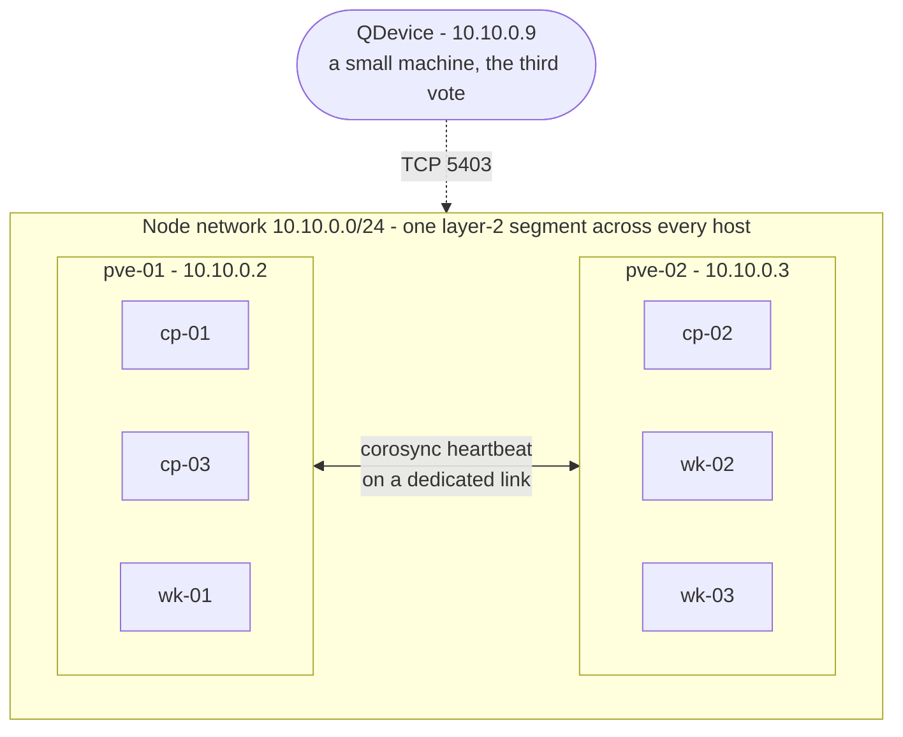
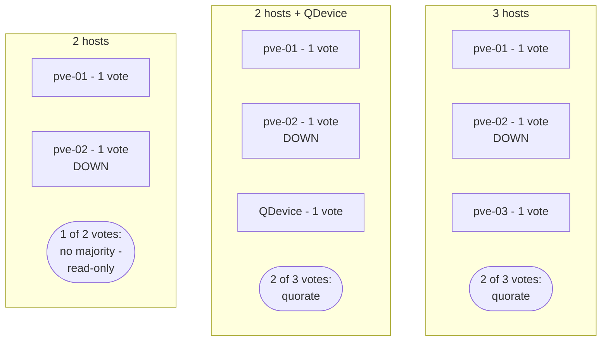
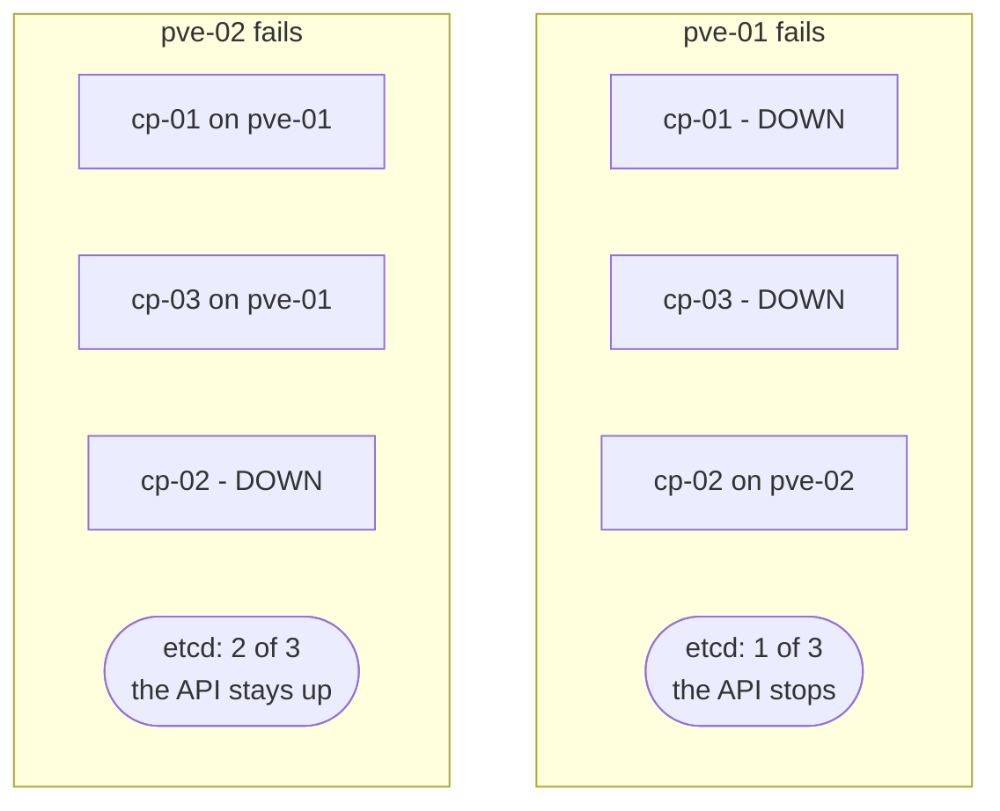
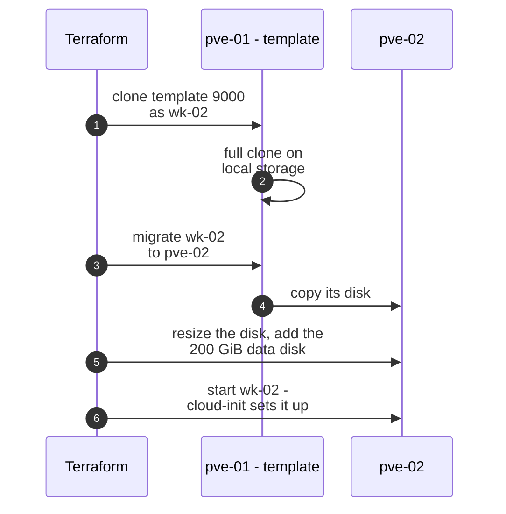
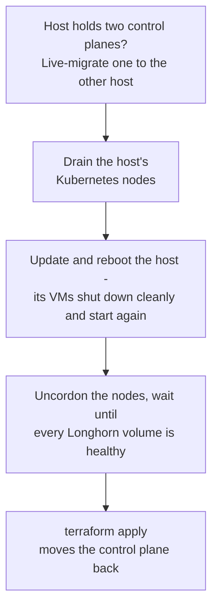

# 10 — Two or more Proxmox hosts

[← Glossary](09-glossary.md) · [Back to the start](README.md)

The other pages treat "Proxmox VE" as one box running six VMs. On a single physical host, that box
is a single point of failure: one power supply, motherboard or disk takes the whole platform down.
This page spreads the VMs over **two or more hosts** — and is honest about what two hosts can and
can't protect. The step-by-step guide is [00 — Proxmox VE](../on-prem/00-proxmox.md).

> [!NOTE]
> **One sentence to remember:** *Proxmox needs a majority of its hosts, and etcd needs a majority
> of its control planes. With two hosts, a QDevice fixes the first — only a third machine fixes the
> second.*

---

## The picture

| Piece | What it is |
|---|---|
| **Proxmox cluster** | The hosts joined into one: shared configuration, one API for all of them, VMs that can move between them |
| **Corosync** | The cluster's heartbeat. It needs low, steady latency — under 5 ms — so it gets its own network link |
| **QDevice** | A tiny daemon on a third machine that only votes. Two-host clusters need it; it runs no VMs |
| **`vmbr0` on every host** | The bridge to one shared network: kube-vip, MetalLB and Cilium all expect the VMs to be neighbours, whichever host they're on |

---

## Two majorities, not one

A cluster that can't tell "the other half is dead" from "the network between us is cut" must
refuse to act — otherwise both halves would carry on separately (a *split brain*). So both Proxmox
and etcd only act with a **majority** of their members. Losing one of two members leaves no
majority.

**Proxmox's majority** is solved by the QDevice. **etcd's isn't** — and that is the key insight of
this page. Three control planes on two hosts means one host always holds two of them:

When the API stops, what is already running keeps serving — but nothing is rescheduled, scaled or
healed until the host returns or etcd is restored. For the Kubernetes API to survive the loss of
*any* host, each control plane needs its own machine.

---

## Two hosts or three?

| | 2 hosts + QDevice | 3 hosts |
|---|---|---|
| Proxmox survives losing any host | Yes — thanks to the QDevice | Yes |
| The Kubernetes API survives losing any host | **No** — not the one with two control planes | Yes |
| Running applications survive losing any host | What runs on the other host keeps serving | Yes, and the lost pods move |
| Cost | Two servers and a tiny third box | A third machine — but it can be small: it only runs `cp-03` |

> **Interview soundbite:** *"Two hypervisors can't give you a highly available control plane: three
> etcd members on two hosts means one host holds two, and losing it loses quorum. A QDevice fixes
> Proxmox's quorum, not etcd's. The cheap fix is a third small host that runs only the third
> control plane."*

---

## The decisions

| Decision | Why |
|---|---|
| **Local disks on each host**, no shared storage | Data is already replicated where it matters: etcd across control planes, Longhorn across workers. Nothing shared means nothing shared to fail |
| **No Ceph under Longhorn** | Replication on top of replication: three Ceph copies of three Longhorn copies is nine copies, and every write waits for both. If you want Ceph, give it to Kubernetes directly instead of Longhorn |
| **No Proxmox HA for these VMs** | Kubernetes already reschedules a lost node's pods — HA at one layer, not two. With local disks, Proxmox couldn't restart a VM elsewhere anyway |
| **Corosync on its own link** | It needs steady latency, not bandwidth; storage or migration traffic on the same link is what breaks clusters |
| **Migrations on the node network**, not the corosync link | A migration can fill a link for minutes |
| **CPU type `x86-64-v2-AES`** | A common CPU baseline, so a VM can live-migrate between hosts with different CPU generations |
| **One template, on one host** | VMs for other hosts are cloned there and migrated — Terraform's provider does it on its own |
| **Terraform migrates, never replaces** | A VM moved by hand during maintenance must not make the next `terraform apply` rebuild it as an empty node |

---

## How a VM lands on the second host

With local disks, Proxmox can't clone a template straight onto another host. The Terraform provider
works around it:

The same mechanism keeps maintenance safe. Terraform reads where each VM really is; if a VM was
moved by hand, the next apply **migrates it back** — live, with its disks — instead of treating it
as a new machine.

---

## What a host failure does

With the two-host layout above (`pve-01`: `cp-01`, `cp-03`, `wk-01`; `pve-02`: `cp-02`, `wk-02`,
`wk-03`):

| Lost | Proxmox | Kubernetes API | Applications |
|---|---|---|---|
| `pve-02` | Quorate, thanks to the QDevice | Up — two of three control planes | Pods from `wk-02` and `wk-03` restart on `wk-01`, if it has room. Volumes run on their one remaining replica |
| `pve-01` | Quorate | **Down** — one of three | Pods on `wk-02` and `wk-03` keep serving; nothing is rescheduled until `pve-01` returns or etcd is restored |
| The QDevice | Quorate — two votes of three | Up | Unaffected |

**Capacity is the other half of availability.** When a host dies, the surviving workers must carry
its pods. Size them for it — or run four workers, two per host.

---

## Patching a host without an outage

One host at a time — and never reboot a host while it holds two control planes: that alone would
stop the Kubernetes API.

---

## What's not done yet

| Gap | Next step |
|---|---|
| Kubernetes sees six VMs, not two hosts: its pod spreading and Longhorn's replica placement can't avoid putting two copies on the same host | Label each node `topology.kubernetes.io/zone=<host>`, from the inventory Terraform writes, and spread on it |
| Not yet run on physical hosts | Written from the Proxmox VE 9.2 documentation and the provider's source; the Terraform side is checked with a plan |

---

## Questions you may get

<b>Why does a two-node Proxmox cluster need a QDevice?</b>

Every host has one vote and the cluster needs a majority. With two hosts, losing one leaves one vote
of two — no majority — and the survivor turns read-only: running VMs carry on, but nothing can be
started or changed. The QDevice is a third voter on a small machine outside the cluster, so the
survivor plus the QDevice make two of three. If the QDevice itself fails, you're no worse off than
without it.

<b>Can two hypervisors give you a highly available Kubernetes control plane?</b>

No. Three etcd members on two hosts means one host holds two of them, and losing that host leaves
one of three — no quorum, so the API stops. You can only choose which host is the critical one. The
QDevice doesn't help: it votes in Proxmox's quorum, not etcd's. The fix is a third machine for the
third control plane — it can be small.

<b>Why not use Proxmox HA for the Kubernetes VMs?</b>

Because Kubernetes already does the failover at the level that matters — it reschedules pods from a
lost node within minutes. Doing HA at two layers just adds moving parts. And Proxmox HA needs shared
storage to restart a VM on another host; these VMs use fast local disks.

<b>Why local disks rather than Ceph?</b>

The data is already replicated by the layer that understands it: etcd across control planes,
Longhorn across workers. Ceph underneath Longhorn would store three copies of three copies and add
write latency. Ceph is a fine choice when it replaces Longhorn — consumed directly by Kubernetes —
and you have at least three hosts.

<b>Why does corosync get its own network?</b>

It is the cluster's heartbeat and very sensitive to latency jitter — Proxmox asks for under 5 ms. A
migration or backup saturating the same link can delay heartbeats enough that hosts think each
other dead. It needs little bandwidth, so a dedicated 1 Gbit link is enough, with the main network
as a fallback link.

<b>How do you patch a host without downtime?</b>

One host at a time. If it holds two control planes, live-migrate one away first, so the reboot
leaves etcd two of three. Drain its Kubernetes nodes, update and reboot it, uncordon the nodes and
wait for Longhorn's volumes to be healthy again before the next host. Then `terraform apply` moves
the control plane back to where the code says it lives.

<b>What happens if someone migrates a VM by hand and then runs Terraform?</b>

By default the Terraform provider sees a VM on a different host as a different VM and plans to
destroy and recreate it — which would wipe that Kubernetes node. The module sets `migrate = true`, so
Terraform live-migrates it back to the host the code names instead — or leaves it, once the code is
updated to its new host.

<b>Why must every host's bridge be on the same layer-2 network?</b>

kube-vip and MetalLB move addresses between VMs by announcing them with ARP, which only works inside
one layer-2 segment, and Cilium's native routing expects nodes to be direct neighbours. A VM on
`pve-01` and one on `pve-02` must be on the same network, not just routable to each other.

---

[← Glossary](09-glossary.md) · [Back to the start](README.md)
