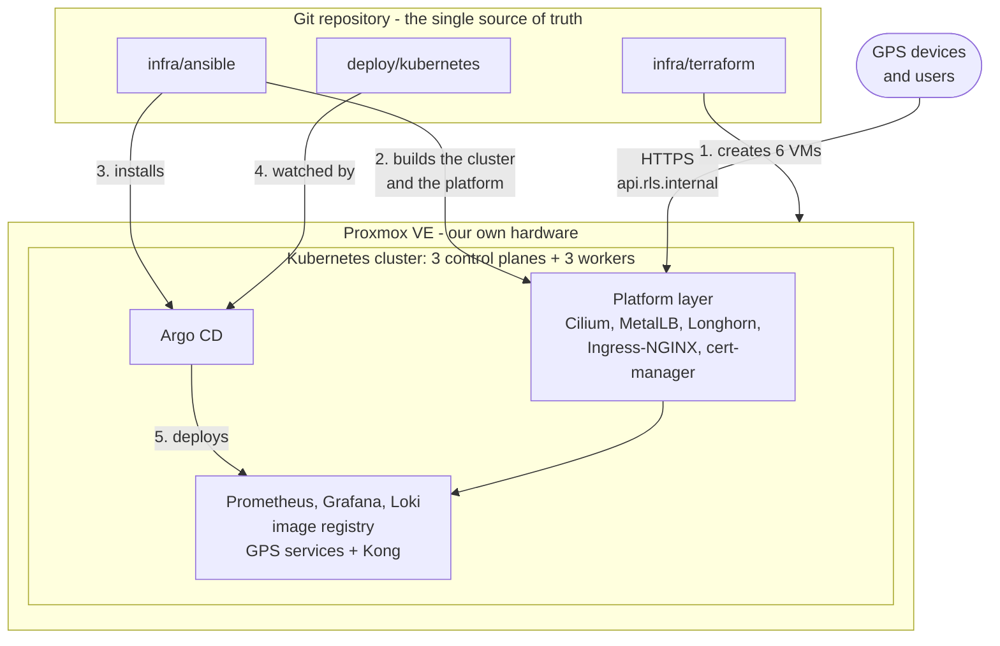

# The platform, explained

A guided tour of how the Realtime GPS Server runs on infrastructure you own — written to be
understood quickly and presented confidently. Every page leads with pictures and plain words; the
step-by-step technical guides are in [docs/on-prem](../on-prem/README.md).

> [!TIP]
> Preparing to present this? Pages 1–3 tell the story, page 7 is the talk itself, and page 8 lists
> the questions you are likely to be asked — with answers drawn from this project.

---

## The 30-second pitch

> *"I built a production-style Kubernetes platform on infrastructure we own, for a real-time GPS
> tracking system. **Terraform** creates the virtual machines on Proxmox. **Ansible** turns them
> into a highly available Kubernetes cluster with **kubeadm**, then adds the platform layers:
> **Cilium** for networking, **MetalLB** for load-balancer addresses, **Longhorn** for replicated
> storage, **Ingress-NGINX** as the front door and **cert-manager** as an internal certificate
> authority. From there **Argo CD** takes over: monitoring with **Prometheus** and **Grafana**,
> logging with **Loki**, a private image registry and the microservices themselves are all deployed
> from Git. Every secret lives in Ansible Vault, every version is pinned, what the nodes download is
> checksum-verified, and a CI pipeline validates the whole thing without needing a cluster."*

---

## The whole platform on one page

**Read it as a story:** Terraform builds the machines, Ansible builds the cluster and its
foundations, Argo CD keeps everything above that exactly as Git describes it, and devices reach the
API through the front door the platform provides.

---

## Reading order

| # | Page | The question it answers | Time |
|---|---|---|---|
| 1 | [The big picture](01-the-big-picture.md) | What is it, what runs where, who builds what? | 10 min |
| 2 | [The twelve layers](02-the-twelve-layers.md) | What does each tool do — and why this one? | 30 min |
| 3 | [How it all flows](03-how-it-all-flows.md) | What happens when a device sends a location, when we release, when a node joins? | 20 min |
| 4 | [Security](04-security.md) | How is it protected, layer by layer? | 10 min |
| 5 | [Reliability and operations](05-reliability-and-operations.md) | What happens when something breaks? How do we upgrade and back up? | 15 min |
| 6 | [Quality and CI](06-quality-and-ci.md) | How do we know it works before touching a server? | 10 min |
| 7 | [The presentation](07-presentation.md) | A 15-minute talk, slide by slide, with what to say | — |
| 8 | [Interview questions](08-interview-questions.md) | 77 likely questions, answered from this project | — |
| 9 | [Glossary](09-glossary.md) | Every term in plain words | — |
| 10 | [Two or more Proxmox hosts](10-proxmox-hosts.md) | How do the VMs spread over physical servers — and what survives losing one? | 15 min |

---

## A three-day study plan

| Day | Read | Then practise |
|---|---|---|
| 1 | Pages 1 and 2 | Draw the one-page diagram above from memory. Explain each of the twelve tools in one sentence |
| 2 | Pages 3, 4, 5 and 10 | Walk through the location-ping journey out loud. Explain what happens when a worker dies — and why two servers can't keep etcd's majority |
| 3 | Pages 6, 7 and 8 | Give the 15-minute talk once, timed. Answer ten random questions from page 8 without notes |

---

## Numbers worth remembering

| | |
|---|---|
| Virtual machines | **6** — 3 control planes, 3 workers |
| Tools in the pipeline | **12** — Terraform → Ansible → kubeadm → Cilium → MetalLB → Longhorn → Ingress-NGINX → cert-manager → Argo CD → Prometheus → Grafana → Loki |
| Kubernetes | **1.36.6**, highly available behind the virtual IP **10.10.0.10** |
| Front door | **10.10.0.200** — every `*.rls.internal` name points here |
| Storage | every volume kept **3 times**, on 3 different workers |
| Argo CD sync waves | **5** — the project (−1), monitoring and logs (0), dashboards and log shipping (1), registry (2), application (3) |
| Secrets in Git | **0** — they live in one encrypted Ansible Vault file |
| Objects validated by CI before any deploy | **201** Kubernetes objects across the 6 Argo CD applications |
